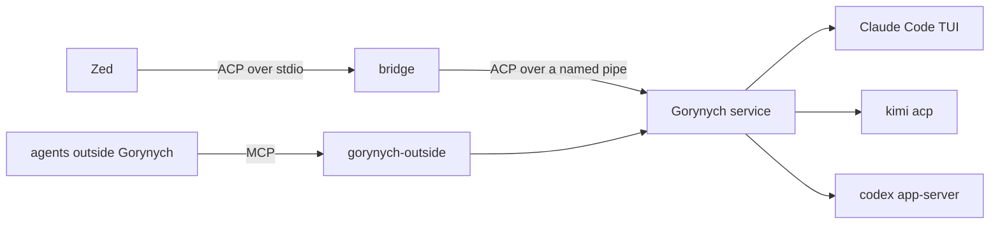

# Gorynych

One body, many heads. Gorynych is one cockpit for several AI coding agents. Each agent runs
as its own unmodified program, under your own login and subscription; Gorynych brings their
conversations, approvals and session lists into one place, and lets the sessions ask each
other for opinions and start child sessions.

**Status: work in progress, early.** Expect missing pieces and breaking changes.

## The idea

- **Native agents.** Claude Code runs as its interactive TUI in a pseudo console, driven only
  by per-launch flags (http hooks, an MCP config, a channel). Kimi Code runs through
  `kimi acp`, Codex through `codex app-server`. Gorynych never edits an agent's own
  configuration.
- **ACP everywhere.** A per-machine service speaks the
  [Agent Client Protocol](https://agentclientprotocol.com) v1 to its clients and to its
  adapters: to a client it is one ACP agent with many sessions, to the agents an ACP client.
  Its own additions go only through ACP's extension points (`_meta`, `_`-prefixed methods).
- **Sessions that talk to each other.** Every session gets a `gorynych` MCP server: it can list
  the others, ask one for its opinion (`ask_agent`), and spawn a child session, which reports
  each finished turn to its parent.
- **Zed as the GUI.** Any ACP client can use the service through a stdio bridge. Stage one uses
  [Zed](https://zed.dev): stock Zed works today; a [Zed fork](https://github.com/Phoenix-/zed) that picks up sessions
  the agents start and shows them as a tree is in progress, with a Windows build of every change
  on its [nightly](https://github.com/Phoenix-/zed/releases/tag/nightly) prerelease.



The design, its decisions and the probes behind them: [docs/design.md](docs/design.md).

## What works today

- **Claude Code** (Windows): feed, approvals, questions as forms, titles, resume after a
  restart, follow-up prompts typed into the live TUI.
- **Kimi Code** through `kimi acp`.
- **Codex** through `codex app-server`: feed, approvals and questions, Codex's permission modes
  (including its automatic reviewer, "Approve for me"), model and effort, names, resume.
- **Peers:** `list_agents`, `ask_agent` in both directions, `spawn_session` with reports to the
  parent, archive and restore.
- **Outside access:** the `gorynych-outside` MCP server lets agents outside Gorynych (Claude Code
  in a terminal or Claude Desktop, Codex, Kimi Code) list Gorynych's sessions, read them and ask
  one for its opinion.
- **Idle unload:** a session nobody uses is unloaded from its agent after 10 minutes
  (`--unload-after`) and woken again when a client, a question or a report needs it.
- **Zed** through the bridge, `Gorynych.Service acp --agent claude|kimi|codex`.

Claude Code delivers other agents' questions through development channels, a Claude Code
research preview. Gorynych asks you once before it starts Claude with them; without them the
questions arrive as ordinary turns.

## Planned

- DeepSeek through its host's HTTP API.
- Claude on Linux and macOS (a Unix PTY host).
- One GUI over several machines: remote services over `ssh -T`, questions between machines.
- The [Zed fork](https://github.com/Phoenix-/zed) (in progress): automatic pickup of sessions and the session tree.

## Getting started

On Windows 10 1809 or later:

1. Install the agents you want and log in with your own account: Claude Code, Kimi Code
   (`kimi login`), Codex CLI (`codex login`).
2. Unzip Gorynych's [nightly build](https://github.com/Phoenix-/gorynych/releases/tag/nightly)
   into `%LOCALAPPDATA%\Programs`.
3. Get Zed, the [fork's nightly](https://github.com/Phoenix-/zed/releases/tag/nightly) or stock
   Zed, and add the `Gorynych: …` agents to its settings.
4. Open a folder in Zed and start a "Gorynych: Claude" (or Kimi, or Codex) thread.

The details, building from source, updating and troubleshooting:
[docs/getting-started.md](docs/getting-started.md).

## Build and test

You need the [.NET 10 SDK](https://dotnet.microsoft.com/download); a Native AOT publish also
needs the C++ build tools ([getting started](docs/getting-started.md#or-build-from-source)).

```
dotnet build Gorynych.slnx
dotnet test --project tests/Gorynych.Tests                   # contract tests, no live agent
GORYNYCH_LIVE=1 dotnet test --project tests/Gorynych.Tests   # also runs Claude (haiku) and Kimi
```

`tools/Gorynych.TestClient` (`gorynych-test`) is a console client that starts the service if it
is not running:

```
gorynych-test new --agent claude --cwd <folder> --wait-title 20 "first prompt"
gorynych-test list
gorynych-test prompt <session> "next prompt"
gorynych-test load <session> [--follow]
gorynych-test opinion --to <session> "a question from another agent"
gorynych-test status | shutdown
```

## Your subscriptions

Gorynych is a tool for one person and their own machines:

- Each agent runs under your own login on each machine. Gorynych never copies credentials
  between machines.
- It runs the unmodified agent binaries, through their own options and protocols.
- It does not serve other people: do not use it to share your subscriptions.

## Documentation

[Getting started](docs/getting-started.md) · [design](docs/design.md) · [service protocol](docs/service-protocol.md) ·
[adapter contract](docs/adapter-contract.md) · [adapters](docs/adapters.md) ·
[ACP types](docs/acp-types.md) · [external clients](docs/external-clients.md) ·
[probes](research/probes/README.md)

## License

[MIT](LICENSE)
