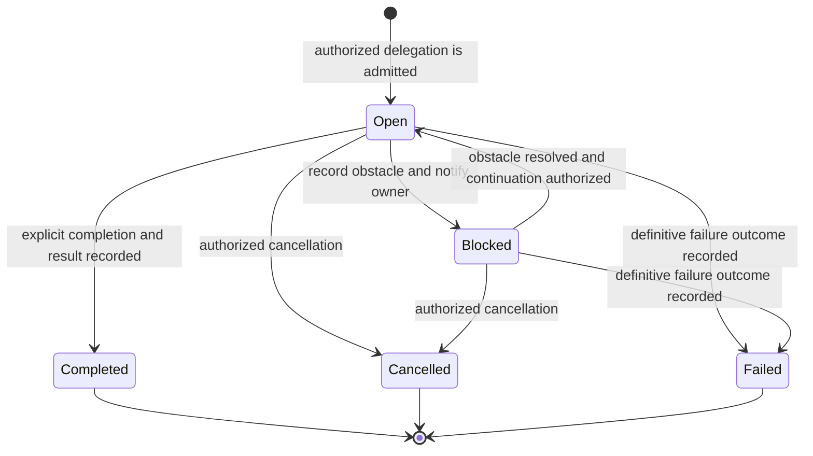

# Delegation, task obligations, and session wake-ups

## Status and scope

**Design direction agreed on 17 November 2026; implementation proceeds in separate iterations.**
This records the discussion following the background-work and host-lifecycle fixes.
It is a reference for implementation and review. Conceptual record and event names below
are not necessarily API names; the linked service documentation defines current contracts.

**Implementation status:** iterations 1 through 3 are built and reviewed; iteration 4 is
implemented and awaiting independent review. The current contracts are
[explicit delegation](messaging.md), [report delivery and retrieval](service-protocol.md#reports),
[report storage](report-storage.md), and reply waits and reminders in [messaging](messaging.md#explicit-reply-expectations).
Iteration 5a now has participant-managed explicit assignment outcomes; trusted user-control
cancellation and later continuations/supervision remain separate work.

Gorynych sessions are persistent conversations. The user can talk to a child
directly, peers can exchange questions, and native background work can outlive a
foreground turn. A coordinator with two reviewers and four coders therefore needs
more information than whether each session is running or idle.

The objective is to account for unfinished work: who owes an action or a response,
what can resume it, and who is informed when progress stops. This does not prove
that an agent's solution is correct or force an agent to complete arbitrary work.

## Contents

- [Decisions and rationale](#decisions-and-rationale)
- [Standards and existing mechanisms](#standards-and-existing-mechanisms)
- [Independent state dimensions](#independent-state-dimensions)
- [Obligations and dependency edges](#obligations-and-dependency-edges)
- [Events, guards, and transitions](#events-guards-and-transitions)
- [Automatic results and explicit outcomes](#automatic-results-and-explicit-outcomes)
- [Waiting, wake-ups, and escalation](#waiting-wake-ups-and-escalation)
- [Cancellation, restart, and recovery](#cancellation-restart-and-recovery)
- [Safety and liveness properties](#safety-and-liveness-properties)
- [Scenarios and acceptance criteria](#scenarios-and-acceptance-criteria)
- [Implementation sequence and open decisions](#implementation-sequence-and-open-decisions)
- [References](#references)

## Decisions and rationale

The following are the agreed direction:

1. **Keep automatic child reports.** Prefer an extra report to losing a needed
   result and leaving the team asleep. A peer- or user-initiated turn is not, by
   itself, a reason to suppress a report that would otherwise be generated.
2. **Distinguish delegation from conversation.** Add explicit delegation to an
   immediate child, checked against the service's stored relationship. An ordinary
   `send_message` is not delegation and does not grant user authority.
3. **Represent obligations explicitly.** Ending a turn does not complete an
   assignment or answer a peer's outstanding question. Completion needs an explicit
   outcome; legitimate waiting needs a registered reason and continuation path.
4. **Use observable dependencies for wake-ups.** In particular, an explicit wait
   for a reply identifies the message and recipient. The service can compare that
   obligation with the recipient's activity before deciding whom to wake.
5. **Keep execution, assignment status, and waits separate.** A session can work
   while awaiting a colleague and a background build. Waiting is not a global
   prohibition on other work or incoming messages.
6. **Make stalled progress visible.** Unresolved waits have an event and a bounded
   review/escalation path. Repeated reminders must not become an infinite model loop.

Automatic-report eligibility retains existing explicit opt-outs, such as
`report: false`, and safeguards against recursive report chains. The new design
does not expand an opt-out into a report, nor does it authorize reports to be
discarded silently. Archived or unavailable recipients need the failure policy
described below.

An initially attractive alternative was to suppress peer-only turn reports and
require the child to publish important revisions explicitly. Two reviewers expose
its weakness: both send an initial review, wake on each other's replies, agree on a
changed conclusion, and forget to publish it to the coordinator. Origin alone does
not establish that the revised result is irrelevant. **That filtering proposal,
including blanket exclusion of user-initiated child turns, was superseded.**

## Standards and existing mechanisms

Standards were checked on 17 November 2026:

- [ACP v1 extensibility](https://agentclientprotocol.com/protocol/v1/extensibility)
  remains the wire boundary. Custom fields belong in existing `_meta` extension
  points; custom methods are `_`-prefixed and capability-negotiated. This document
  adds no root fields to ACP types and does not negotiate ACP v2.
- [MCP Tasks 2026-07-28](https://github.com/modelcontextprotocol/ext-tasks/blob/main/specification/2026-07-28/tasks.md)
  is the closest lifecycle reference: durable task identity, explicit operational
  outcomes, and deferred result retrieval. The extension repository labels that
  schema Stable. It does not define agent parentage, delegated authority, peer
  dependency routing, or when to wake an LLM. A later wire proposal must explain its
  mapping or extension; full adoption is not a prerequisite for recording this model.

The implementation baseline for this discussion is `1ee67976e4d37e907bada6c492be667a9aaf6f51`:

- [Messaging](messaging.md) has durable acceptance, correlated replies, queued
  ordinary turns and automatic wake. Acceptance is not model consumption or an
  answer. There is currently no managed wait-registration tool. Inter-session
  messages do not steer a running turn, even for steer-capable adapters.
- [Child reports](service-protocol.md#reports) describe turn outcomes, use a bounded
  final-text preview, and currently have failure/archival limitations. Broad report
  delivery is a baseline to preserve; durable full-result records are future work.
- [Session activity](session-activity.md) separates foreground activity from full
  and partial background observations. Unknown is not confirmed idle or empty.
  Background retention protects processes; it does not promise a model will resume
  when the work ends.
- [Steering](steering.md) already defines user-facing steering mechanisms and
  recovery rules. Extending managed messages to steer is separate future work.

Existing contracts remain authoritative until an implementation updates them.

## Independent state dimensions

Use a product of small state machines rather than one session-wide `waiting` flag.
The following assignment states are a **proposed representation**, not a finalized
storage schema:

| Dimension | Values or observations | Meaning |
| --- | --- | --- |
| Assignment | `open`, `blocked`, `completed`, `cancelled`, `failed` | Whether a particular delegated obligation remains and why |
| Foreground execution | Existing `running`, `idle`, `requires_action`, or unconfirmed observation | Whether work is executing now; never inferred from a final sentence |
| Native background | Full/partial observed references, confirmed empty, or unknown | Evidence about native work, with existing retained holds |
| Dependencies | Zero or more individually registered waits | What this assignment or session expects from messages, tasks, native work, or people |
| Availability | Existing maintenance, user stop, permissions, transport and interactivity constraints | Whether automatic execution is currently allowed |

`open` is an outstanding obligation, not a claim that the CPU or model is busy.
`blocked` means a recorded obstacle has been exposed to its owner, not permission
to forget the assignment. Terminal assignment states are explicit outcomes; they
do not erase late messages or results from history.

Foreground turns and waits change independently of this diagram. `turn ended`,
`reply accepted`, and `background became empty` have no implicit edge to
`completed`. Reopening or superseding a terminal assignment requires an explicit,
correlated decision; a stale timer cannot do it.

## Obligations and dependency edges

The service owns identity, correlation and transitions. Model-written text cannot
impersonate a parent or invent a service-observed transition.

Parent-authored delegation continues the user's authorized assignment. It grants
no new authority, cannot override user restrictions, and must be identified by
service-verified metadata rather than a sender-supplied label. An explicit review
scope remains read-only unless the user authorized more. Wake-up messages inherit
the same limits.

An authorized spawn's initial prompt is the first delegated assignment: establish
the parent/child relationship and assignment before dispatching that prompt.
Existing sessions need an explicit admission/migration policy; do not reconstruct
open work from historical final text and start watchdogs for all of it. A later
direct user prompt does not implicitly complete, replace or relabel an existing
assignment, although an explicit user stop or task change must be respected.

| Conceptual record | Required meaning |
| --- | --- |
| Assignment | Stable ID; owner/parent and child; scope and authorization reference; originating request; revision; status and outcome/result references |
| Execution | Session and native/service turn identity; triggering cause; related assignments/messages; known acceptance/consumption evidence |
| Wait | Stable ID and generation; waiter; assignment if applicable; kind and concrete target; reason; state; next review; wake/escalation receipts |
| Result/report | Stable immutable ID; child and recipient; assignment/turn/message correlation where known; initiator; turn outcome; separate assignment outcome; complete text or exact retrieval reference |

Initial wait kinds can cover a correlated reply, a child assignment, native
background work, user input/permission, and an external event. A bare `send_message`
does not create a reply obligation: notifications need no acknowledgement. A sender
must explicitly declare that it awaits a response to message M. The service checks
that M belongs to that sender and names the expected recipient. Unsupported or
evicted references fail visibly rather than creating an unresolvable edge.

The partial graph has sessions, assignments and concrete event references as
nodes, with registered waits as edges. It covers declared dependencies, not every
semantic dependency in an agent's reasoning. The service can identify `A waits for
B`, inspect B's activity, and recognize a direct mutual wait. General cycle
detection is optional; a bounded review path also handles longer cycles and missing
replies without claiming to understand the task.

The number of simultaneous assignments per session, ownership transfer, and
cross-service waits remain open. Correlation must not assume that one persistent
session has exactly one task forever.

## Events, guards, and transitions

This table is the proposed reducer contract. Updates, resulting obligations and
durable delivery intents must commit consistently before success is acknowledged.
The exact transaction/outbox mechanism remains an implementation decision.

| Event | Guard/evidence | State change and required effect |
| --- | --- | --- |
| Admit delegation | Caller is the stored immediate parent; existing scope, approval and mode checks pass | Record assignment and enqueue its execution. Otherwise refuse before delivery with an actionable error pointing peer conversation to `send_message`. |
| Start execution | Delivery is eligible under existing gates; no duplicate dispatch claim | Record execution cause. Preserve all unrelated assignments and waits. |
| Accept or consume additional input | Trusted service metadata; distinguish queued, adapter-accepted and consumed where observable | Correlate the input; do not replace the original obligation or declare another input consumed without evidence. |
| End execution | Confirmed turn end and available outcome | Record and automatically report the eligible turn outcome, including error or absent final text. Keep unfinished assignments; evaluate continuation obligations. |
| Register wait | Owned, valid target and defined continuation/review policy | Add a wait edge. Permit idle while awaiting that event; continue accepting other input. |
| Accept correlated reply | Reply ownership validated; awaited message matches | Make the response available and resolve the response wait with a durable delivery/wake intent. Reading and applying the reply remain subsequent work. |
| Observe background transition | Valid native reference and snapshot semantics | Reevaluate related waits. Work disappearance is not proof of successful build or task completion; unknown does not resolve the wait. |
| Record blocked outcome | Agent or service identifies a specific obstacle | Record obstacle and notify owner. Preserve applicable dependencies and existing approval handling. |
| Record explicit completion | Assignment is open with the correct revision; result/outcome recorded | Mark `completed`, preserve full result, notify owner, and dispose or transfer remaining obligations explicitly. A blocked assignment first records resolution of its obstacle. |
| Cancel or pause | Existing authorized user/owner operation | Cancel the assignment or suspend automatic continuation as specified by that operation; invalidate obsolete wake intents. A turn cancel alone must never provoke immediate automatic retry. |
| Review deadline fires | Same unresolved wait generation; fresh activity, reply and availability check | Wake the responsible actor, reschedule a justified review, or expose a blocked/escalated outcome. Never infer task success. |
| Lose transport or host | Connection loss, then authoritative recovery evidence if available | Keep uncertainty and obligations. Reconcile surviving turns before scheduling new work; report definitive failures without duplicating an uncertain prompt. |

Completing one assignment must not silently discharge a reply owed to another
session. Conversely, receiving a peer reply closes a response dependency, not the
review or coding assignment that motivated it. A partial answer can lead to a new
explicit wait; it cannot extend the old wait invisibly.

## Automatic results and explicit outcomes

An automatic report means "this turn ended with this outcome". It is distinct from
the explicit claim "assignment X is complete". Both error/cancellation reports and
turns with no final text matter to the parent.

Keep report delivery independent of whether the turn began with delegation, peer
conversation, a direct user prompt or a later reminder, subject to existing report
opt-outs and recursion safeguards. Mark the cause and assignment correlation;
uncertain relevance favors delivery. There is no mandatory duplicate `send_message`
for an ordinary child result.

Preserve the full result before acknowledging its publication. A preview must say
that it is truncated and link to that exact immutable result, not "the child's
latest message". A later revised review gets a new result ID even after explicit
completion. It remains visible and reportable; it does not silently reopen a
cancelled or completed assignment.

Blocked or archived recipients require a durable pending notice or a visible
delivery-failure/escalation outcome. The existing log-only report drop is not the
future reliability contract. Restoring an archived session must not itself restart
cancelled work. Retention limits and report opt-outs must produce an explicit
policy outcome rather than losing a previously accepted obligation.

Completion is the agent's explicit claim. It is not proof of correctness, parent
acceptance, successful tests, or absence of intentionally running dev servers.
Exact tool names, parameters, completion-result capture, and parent acceptance or
reopening semantics need a separate wire proposal.

## Waiting, wake-ups, and escalation

### Reply waits

At review time the service uses its own wait record and fresh observations, not
phrases parsed from the last assistant message:

| Recipient condition | Action |
| --- | --- |
| Correlated reply already exists | Resolve the wait and ensure its queued delivery; do not remind the recipient |
| Foreground work or an applicable request is queued/running | Leave that work intact; retain the wait and next review |
| Confirmed idle, unanswered request, no applicable recorded obstacle | Issue one correlated reminder to the recipient at its normal input boundary |
| Waiting on relevant native work or user action | Expose that reason to the waiter; preserve the event/review path |
| Waiting on the waiter, or repeatedly making no response | Expose the dependency facts to the author/owner or coordinator instead of alternating reminders indefinitely |
| State unknown, disconnected, or delivery uncertain | Reconcile or report uncertainty; never treat unknown as permission for duplicate native dispatch |

A reminder should name the original request and expected action: "A is waiting for
your response to M; answer it or record the obstacle." It grants no new authority,
does not cancel a running tool, and does not bypass permissions or user stops.

A report sent to the parent is not a correlated reply to a peer. The service must
not close a peer's wait merely because the recipient emitted a final message.
Any incoming message can still resume a waiting session under the existing
delivery contract; waiting for M does not mute a question N.

### Unfinished assignments and background work

An open assignment whose foreground execution ends without explicit completion,
blockage or a valid continuation path is eligible for a completion reminder. Apply
this only to admitted assignments, not every idle imported conversation.

Native background references can justify sleeping when they are relevant to the
assignment. A long-lived unrelated dev server must not disable all supervision.
Partial observations and unknown snapshots require conservative reconciliation;
existing background holds remain intact. If the adapter cannot identify the native
work, an explicit bounded wait/review is needed rather than invented completion.
Finishing background work must arrange a continuation when needed; it cannot rely
on an idle native harness resuming the model automatically.

### Bounds and mutual waiting

Reminders have a bounded budget per unresolved obligation generation. Initial
budgets and review intervals are open configuration decisions. After unsuccessful
reminders, persist and deliver an escalation rather than repeatedly spending model
turns. "Still waiting" alone does not reset the budget indefinitely.

Restarting a timer, re-registering the same unanswered request, or receiving an
unrelated message/ACK must not create an unlimited fresh budget. Exact budget
renewal requires an explicit policy and observable resolution or owner decision.
Each wait also needs an owner-visible overdue/escalation deadline. Reviews may
observe legitimately running work and defer a reminder, but cannot hide an aging
wait indefinitely. An overdue notice does not cancel the work or declare it failed.

For two reviewers, show facts: "A waits for B's reply to M; B waits for A's reply to
N." The author or coordinator can ask one to provide its current findings first.
The service schedules attention; it does not invent the review conclusion or claim
to resolve semantic deadlocks. An unavailable owner leaves a visible blocked
obligation; a root session exposes the issue to the user.

All stale timers and queued reminders recheck wait generation, reply presence,
execution state and availability immediately before dispatch. One reminder may
cover several eligible waits, but no unanswered obligation may disappear during
coalescing. A late reply remains visible if the wait was already escalated.

## Cancellation, restart, and recovery

Persist assignments, waits, generations, result references and pending
notifications independently of a host's bounded activity replay. Rebuild timers
from durable deadlines, then reconcile host executions and mailbox delivery claims.
UI epoch/revision changes do not reset a task's identity or reminder budget.

Reuse the existing uncertain-delivery rules: service acceptance, native dispatch
and model consumption are different facts. A crash after native handoff must not
cause blind prompt replay. Reconcile, deduplicate or expose uncertainty. Require
idempotent service transitions and stable notification identity, without claiming
exactly-once LLM execution.

Explicit cancellation closes or suspends the relevant continuation obligations
before a timer can restart them. Preserve existing semantics for accepted mailbox
messages: cancelling their sending call does not withdraw them. A late reply or
background completion can still be recorded and reported without reviving cancelled
work. Distinguish a user cancel from an unexpected interrupted turn; the latter
needs an exposed outcome and an authorized recovery decision, not an automatic
success or an unbounded retry.

Maintenance, permissions, unavailable native sessions, and authentication failures
remain existing execution constraints. Wake scheduling cannot clear them or alter
native configuration. Process retention and background unload/migration protection
continue to follow their own contracts; a sleeping model does not require keeping
every idle process alive forever if obligations can be recovered safely.
In particular, this proposal does not extend the existing bounded orphan-host
grace (10 minutes for busy orphan hosts in the discussion baseline). Its expiry
requires an honest interruption/recovery outcome, not a completion claim.

## Safety and liveness properties

These are properties to establish during implementation, not proofs supplied by
this discussion. Let `pending(w)` mean an unresolved registered wait and
`eligible(s)` mean that existing execution policy permits a new turn for session s.

**Safety:**

- Every admitted assignment has one stable identity and a service-verified owner.
- A turn end never implicitly changes an open assignment to completed.
- Resolving a wait requires its correlated event or an explicit recorded disposition.
- Unknown activity never becomes confirmed idle, empty, successful or answered.
- An ineligible session is never restarted by a watchdog.
- At most one native dispatch claim exists for the same wake intent/generation;
  a lost response is not proof that no dispatch occurred.
- A terminal assignment cannot be reopened by a stale event. Results and notices
  remain available under their explicit retention policy.
- Every eligible automatic report is delivered or has a visible pending/failure
  disposition; initiator-based relevance guesses do not discard it.

**Liveness and visibility, assuming a running service, fair event/timer processing
and usable persistence:**

- Each open obligation has executing work, a registered continuation with a next
  review, or a visible blocked/escalated disposition.
- `pending(w)` eventually leads to its correlated event being handled, eligible
  attention being scheduled, or an exposed blocker/escalation. It cannot remain
  an unexamined edge forever.
- A reply becoming available eventually reaches its waiter or produces a visible
  delivery outcome; observing a reply does not remove its pending delivery intent.
- Repeated nonprogress exhausts a bounded reminder budget and surfaces the issue.
- After restart, retained unresolved obligations regain the same continuation or
  escalation path rather than relying on a model to remember them.

These properties guarantee accounted-for progress or visible inability to progress.
They do not guarantee a correct answer, termination of an external build, a human
response, or successful completion of every assignment.

## Scenarios and acceptance criteria

Use deterministic reducer/scheduler tests with a controlled clock and delivery
barriers before expensive model runs. Runtime tests must exercise actual mailbox,
host and restart boundaries; reducer tests alone do not prove native recovery.

| Scenario | Required observation |
| --- | --- |
| Parent delegates; child ends a turn without an explicit outcome | Automatic report arrives; assignment stays open; a continuation check remains |
| Non-parent attempts delegation | Refused before delivery with an actionable error; ordinary peer messaging remains available |
| Two reviewers exchange questions after initial reports | Later eligible reports still reach the coordinator; initial final text did not close their assignments |
| Explicit wait for M; recipient goes idle unanswered | Recipient gets one correlated reminder; its resulting response reaches the waiter |
| Both reviewers await each other | Incoming questions still arrive; dependency facts become visible and bounded escalation prevents silent indefinite waiting |
| Reply commits while a deadline fires | One consistent resolution; stale wake is cancelled or harmless; reply is still delivered |
| Reply is only partial or addressed to a different message | Matching is by identity; no unrelated wait closes; further waiting is explicit |
| Parent/report final exists but peer reply is absent | Peer's reply wait remains unresolved |
| Related background build outlives the turn | Sleep is legitimate, native retention holds remain, and completion/review schedules the required continuation |
| Unrelated dev server or partial/unknown snapshot | No blanket exemption from supervision and no fabricated task completion or lost background hold |
| User intervenes or a future peer steer is accepted | Original obligations survive; acceptance is not fabricated consumption; unrelated task status is unchanged |
| Child explicitly completes, then later revises its review | Separate completion claim and immutable results; revised eligible report arrives without silently reopening the task |
| User cancels as a reminder is queued | No automatic retry; stale generation cannot revive the work |
| Parent is archived or a report cannot be delivered | Durable pending/visible failure policy is exercised rather than log-only loss |
| Conductor restarts before or after native handoff | Obligations recover; uncertain dispatch is not replayed blindly; no duplicate reminder storm |
| Repeated reminders receive no usable response | Budget exhausts; owner/user sees the unresolved obligation |
| Closed host route, native failure, or no final text | Honest interruption/failure report; assignment is never inferred completed |

## Implementation sequence and open decisions

The user approved six independently reviewable rollout iterations:

| Iteration | Deliverable | Acceptance boundary |
| --- | --- | --- |
| 1. Explicit delegation (**built**) | Managed `delegate_task`, immediate-parent validation, trusted envelope and durable correlation, including initial spawn | New/existing session instructions, rejected relationships, retained retry/restart, queued access checks and failed spawn persistence; existing messaging and reports preserved |
| 2. Reliable complete reports (**built**) | Immutable full result identity/retrieval, cause/outcome correlation and durable delivery or visible failure | Long results, revised reviews, restart during publication/delivery, unavailable or archived parent; broad automatic report eligibility preserved |
| 3. Observable reply waits (**built**) | Explicit response dependency on message M, persistence, resolution and diagnostics | Mutual waits remain visible and receive new input; restart restores edges; ordinary notifications acquire no reply obligation; no new automatic reminders yet |
| 4. Targeted reply reminders (**under review**) | Fresh activity checks, bounded recipient reminders and owner escalation | Reply/deadline races, cancellation, maintenance and uncertain handoff; enable first on an opted-in test group; disabling reminders preserves messaging and wait records |
| 5. Assignment outcomes and other waits (**5a participant API; user control pending**) | Explicit completed/blocked/cancelled outcomes and background/child/user-action continuations | Partial final text does not complete work; unrelated native work grants no blanket exemption; initially observe without the general completion watchdog |
| 6. General completion supervision | Detect an open admitted assignment left without execution, valid waiting or an exposed obstacle | Seven-agent team scenario, native background work, mutual waiting, user intervention and restart; only now enable completion reminders |

Each iteration must be usable and reviewable without deploying the next one. The
first two are standalone improvements. Preserve running hosts and native threads
across service updates; cached creation instructions require fresh tool and
per-message guidance rather than rewriting native configuration. Early steps can
ship on the service/MCP side; a dependency-graph GUI is a later presentation choice.

Specify exact tool/wire contracts and capability compatibility for each iteration
before implementing it. Use deterministic tests and scoped runtime checks, then
review the change independently. Enable scheduling only after its passive state
and cancellation/recovery behavior have been observed. Measure real team workflows
before considering coalescing or other noise policy.

Open decisions include exact tools/wire and capability negotiation; completion and
reply-expectation registration; assignment cardinality; review intervals and reminder
budgets; background-to-assignment evidence; retention and transactional storage;
archival/root-user escalation presentation; blocked/paused/failed distinctions;
late-result acceptance and explicit reopening; and any future managed-message
steering. None is settled by choosing a tool name in this document.

General cycle detection, automatic summary-based filtering, and rate limits are
not prerequisites. Any later noise reduction must preserve the no-silent-loss
properties and remain separately reviewable.

## References

- [Project design](design.md), [messaging](messaging.md),
  [child reports](service-protocol.md#reports), [session activity](session-activity.md),
  [steering](steering.md).
- [ACP v1 extensibility](https://agentclientprotocol.com/protocol/v1/extensibility).
- [Official MCP Tasks extension and schema status](https://github.com/modelcontextprotocol/ext-tasks/blob/main/README.md),
  [2026-07-28 task lifecycle](https://github.com/modelcontextprotocol/ext-tasks/blob/main/specification/2026-07-28/tasks.md).
- [OMP result routing at 6f03614](https://github.com/can1357/oh-my-pi/blob/6f03614d761366972e80e84e25d1418ed678d2c7/packages/coding-agent/src/task/executor.ts#L3697-L3789):
  useful provenance tracking, but peer-only suppression and reliance on explicit
  publication are not adopted as Gorynych's default reliability policy.
- [Codex completion routing at 05ae1b0f](https://github.com/openai/codex/blob/05ae1b0fdd5ab412d24248acc76c5d9f6f275440/codex-rs/core/src/agent/control/completion.rs#L33-L150):
  delivery/wake modes and parent result routing are separate concerns.
- [Claude Agent Teams](https://code.claude.com/docs/en/agent-teams) and
  [LangChain subagents](https://docs.langchain.com/oss/python/langchain/multi-agent/subagents):
  comparisons, not evidence of Gorynych runtime guarantees.

The earlier deferred note in local commit `f37c50a` proposed initiator-based report
exclusions. The decisions above supersede those exclusions; the note was not
integrated into `main`. No runtime capability is introduced by this documentation.

### Passive reply and child continuations (5b first slice)

A managed assignee may use `update_continuation` with an assignment source, ID, exact generation, expected revision, operation ID and `register`, plus either their retained reply-wait message ID or the source, ID and exact generation of an immediate child assignment for which they are the parent. `withdraw` removes the continuation. Parent and assignee can read it; it does not change the owner's outcome or start a turn. Terminal owner outcomes retire the continuation without changing the dependency.

Reply references bind the wait's message ID, waiter and immutable admission sequence. Read reconciliation reports `waiting`, `ready`, `cancelled`, `undeliverable`, `unknown` or `unavailable`, with separate `requestDelivery` and `replyDelivery`. `ready` means that the reply was accepted, not delivered to a native agent or read by one. Child continuations report `waiting`, `blocked`, `ready` after a terminal child outcome, or `unavailable`; they expose a generic blocker rather than the child's private summary. A terminal child does not complete its owner.

Same-store admission validates the reference under the owner's publication lock. Cross-store admission binds a trusted target snapshot without nesting store locks; a dependency may disappear between observation and publication. On each read the original identity is checked again, and a missing or replaced dependency is `unavailable`, never the state of a replacement. Retained operation retries do not require the target to remain present. No timers, wakeups, native background, user-action targets or changes to report delivery are part of this slice.

A child continuation also exposes the exact independent assignment `delivery`. For an open child, `failed`, `not_started` or `suppressed` yields `undeliverable`, while `uncertain` yields `unknown`; terminal outcomes remain `ready` and blocked outcomes remain `blocked`. These dispositions neither change the owner outcome nor start or repeat a turn.

A managed assignee can discover its own observed headless Claude tasks through `list_background_tasks` and register one with `update_continuation` using `background_ref`. Each listed task includes a bounded `reference` selector; pass it as `background_ref`. The first registration requires that selector to match the calling assignee and the exact current trusted host, process stream, task ID and observation revision. If the observation changes, list again. The selector is not an authority credential. The service persists the verified evidence and a bounded selector fingerprint for idempotent retries. A newer complete observation on the same host and stream that omits that task yields `ready` to inspect; it does not prove success. If the host or route is unavailable, evidence is partial or unknown, or the stream is replaced, the view is `unknown`. Retrying an already accepted operation remains idempotent if its evidence is later unavailable. Registration, withdrawal and owner cancellation do not stop or wake the native task.

### Passive assignment diagnostics (step 6 first slice)

Participant-scoped assignment reads and lists include a bounded, computed `diagnostic`. This is observation only; it never schedules or grants authority. `reasonCode` distinguishes explicit terminal and blocked outcomes, queued or unconfirmed assignment handoff, confirmed delivery failure, dependency queue/handoff/failure/unknown, valid reply/child/background waiting, reply delivery disposition, and `ready_to_inspect`. The existing outcome, delivery and continuation fields remain independent and authoritative for their respective facts.

`execution` is always `unknown` in this slice. An aggregate session activity is exposed separately with `session_only` scope and unverified freshness: another assignment, user turn or background task does not prove this assignment is executing. An idle default is returned as unknown, not confirmed idle. For a hosted delegation with delivered input, an exact observed initial terminal and later strict loaded foreground idle on the same route, an open assignment with no recorded continuation reports `open_without_recorded_continuation`. This is an actionable observation, not an abandoned or failed outcome, and grants no wake authority. Other paths without that proof remain `no_correlated_execution`. Existing continuation and explicit outcome states take priority.

For a hosted explicit delegation, `diagnostic.initialTurn` can be `terminal_observed` after its exact generated prompt receives an ordinary `end_turn` response, delivery is durably recorded, and its terminal is journaled on the same uninterrupted host route. This in-memory, one-per-session observation is independent of report capture and is lost on service restart, route removal/replacement, or a later observed assignment. All other paths return `unknown`; it does not establish current execution, idle, success of the assignment, or absence of a continuation.

`diagnostic.foregroundIdle` is a separate, ephemeral observation. For the exact currently retained hosted delegation terminal, `loaded_idle_observed` requires a later live Codex `IdleThreadStatus` for a loaded thread, on the same uninterrupted admitted host route, with no subsequent prompt, native activity or permission request and no currently pending work. Replay, history, generic idle, not-loaded, errors, closed or replaced routes and other adapters cannot establish it. A new activity invalidates this correlation even if another idle arrives later. Otherwise it is `unknown`; it does not classify the assignment as abandoned or authorize a wake.

The exact response arrival samples an in-memory activity fence synchronously before the RPC response task completes. Activity or permission intervention before terminal publication invalidates later idle correlation even if it has already ended; the independently observed terminal can still be retained. Codex notLoaded, thread/closed, systemError and unknown lifecycle status revoke this correlation for the old terminal, including during history import. A later idle on the same connection cannot restore it; a new exact terminal is needed.
