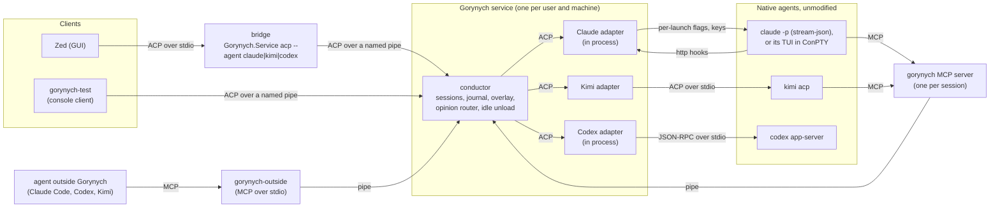
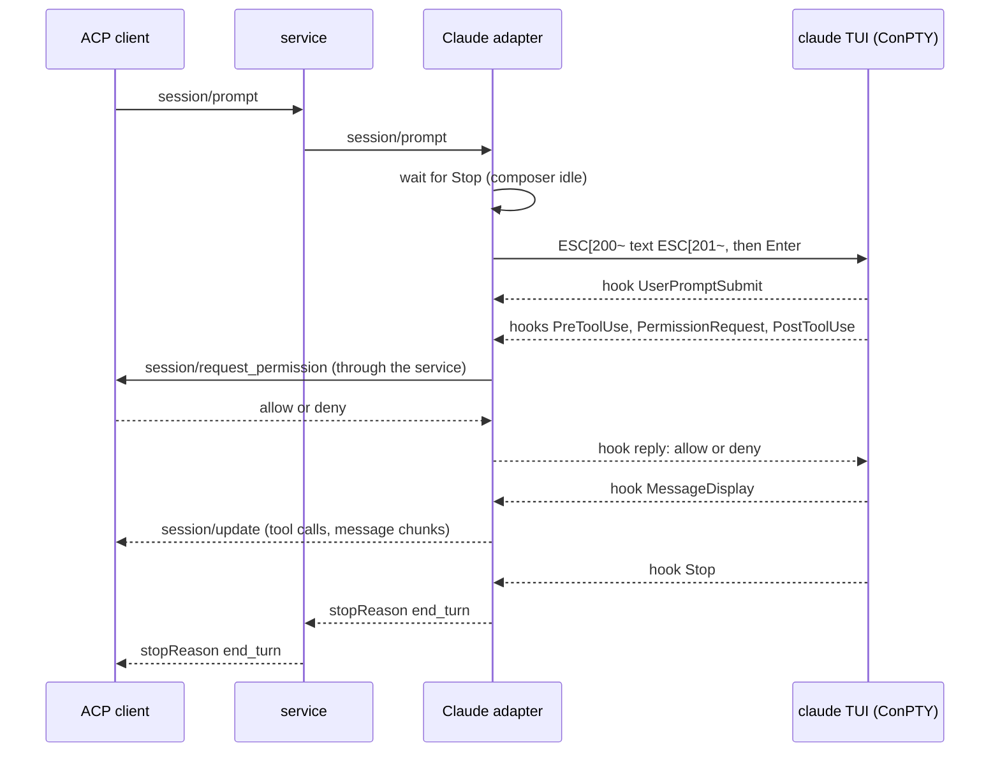
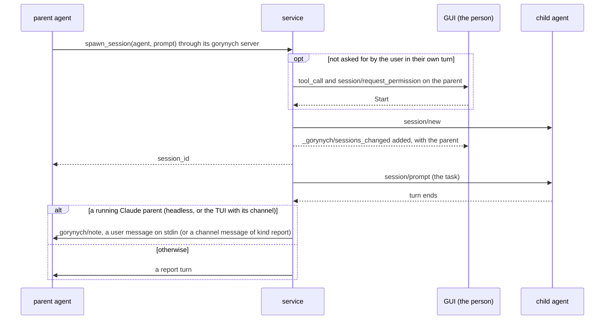
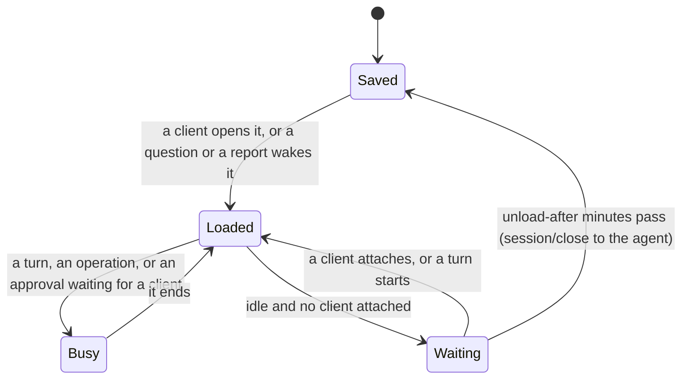

# Design

Why Gorynych is built the way it is: the decisions, the architecture, how it maps onto ACP,
what the probes proved, and what is still a plan. The specifications that the code follows
live next to this file: [service protocol](service-protocol.md),
[adapter contract](adapter-contract.md), [adapters](adapters.md), [ACP types](acp-types.md),
[external clients](external-clients.md). Where this document and a specification disagree,
the specification wins.

Status words used below: **done** (in the code and tested), **in progress** (on a branch),
**planned** (decided, not started), **open** (not decided or not checked).

## Contents

- [Goal](#goal)
- [Decisions](#decisions)
- [Architecture](#architecture)
- [Claude Code without touching its configuration](#claude-code-without-touching-its-configuration)
- [Kimi, Codex and DeepSeek](#kimi-codex-and-deepseek)
- [The protocol: ACP and its extensions](#the-protocol-acp-and-its-extensions)
- [Sessions: catalog, titles, archive](#sessions-catalog-titles-archive)
- [Sessions that talk to each other](#sessions-that-talk-to-each-other)
- [Waking and idle unload](#waking-and-idle-unload)
- [Agents outside Gorynych](#agents-outside-gorynych)
- [The GUI](#the-gui)
- [Stage one and what comes next](#stage-one-and-what-comes-next)
- [Probe results](#probe-results)
- [Open questions and risks](#open-questions-and-risks)

## Goal

Two to five coding agents at once, interactive and supervised, from different vendors. The
point is a plurality of opinions from different models, so the agents must be able to ask each
other, and the person must see all of them in one place: one feed per session, one kind of
approval card, one session list, without reading terminals.

## Decisions

- **Native harnesses, unmodified.** Each agent runs as its own program, the one its vendor
  ships, under the person's own login. Gorynych adds no model calls of its own and never
  replaces a harness with a bare model.
- **Never edit an agent's own configuration** (`~/.claude`, `~/.codex`, `~/.kimi-code`).
  Everything goes through per-launch options and the agents' own protocols, so starting or
  removing Gorynych changes nothing in how the agents behave on their own.
- **A structured protocol per harness, no screen scraping.** Kimi speaks ACP (`kimi acp`),
  Codex has `codex app-server`, Claude Code has stream-json (`claude -p`). In Claude's TUI
  fallback the terminal is used only to type and to answer the few dialogs that need a key.
- **Claude Code runs headless; the TUI is the fallback.** The unmodified `claude` binary runs as
  `claude -p` with stream-json in and out, under the person's own plan login, one process per
  session (decided 9 November 2026). Anthropic's help center says `claude -p` and the Agent SDK
  signed in with a plan draw from its limits, and the legal page does not prevent signing in
  to the unmodified binary with one's own subscription. The interactive TUI in a pseudo console
  stays built and tested behind `--claude-transport tui`: a separate credit for `-p` was
  announced and then paused in 2026, and `--bare` (no OAuth login) is to become the default for
  `-p`. Switching needs no migration; both use Claude's own transcripts.
- **Service and GUI are separate from day one.** A per-user background service on each
  machine owns the agent processes; a GUI connects to it, and later to several services.
- **ACP v1 between them**, with own additions only through ACP's extension points. The
  service is an ACP conductor (the proxy-chains RFD); adapters are ACP agents.
- **Adapters are build-time assemblies** (or external ACP executables). Loading assemblies at
  run time would break Native AOT, which the service keeps.
- **Native state is the source of truth.** Titles and archive live in the harness when it has
  them; the service keeps only an overlay for the rest.
- **One person, own subscriptions.** Each machine uses its own login; credentials never move
  between machines; Gorynych serves nobody else.
- **Standards first.** Before inventing a format, name the closest standard and conform to it
  or extend it through its documented extension points.

## Architecture



- **The service** (`src/Gorynych.Service`) is a per-user background process, not a Windows
  service: session 0 could not start agents under the person's login without storing a
  password. The bridge, the test client or the outside server starts it when it is not
  running, and it outlives them. One instance per user and pipe, across logon sessions.
- **Transport.** Locally, a named pipe (`gorynych-acp-<user>`) carrying ACP's stdio framing,
  open only to the current user. Plain ACP clients start agents over stdio, so the **bridge**
  (`Gorynych.Service acp --agent <name>`) passes ACP between its stdio and the pipe and scopes
  the connection to one agent. Remote machines: planned, over `ssh -T`.
- **The conductor** keeps what is common: process supervision, a bounded journal per session
  (replayed by `session/load`), the overlay (archive flags, names given at spawn, tombstones,
  parent links), the router for questions between sessions, and the idle unload. Everything
  particular to an agent sits behind the [adapter contract](adapter-contract.md).
- **Adapters are ACP agents.** An external one is an executable that speaks ACP over stdio
  (`kimi acp`); an own one (Claude and Codex) is an assembly with an ACP interface over an
  in-memory link, so moving it into its own process later means only wrapping it in JSON-RPC.
  DeepSeek Harness speaks ACP itself; its adapter is a thin in-process proxy in front of
  `dsh --profile acp`.

## Claude Code without touching its configuration

All of the Claude integration rests on the flags of one launch and Claude's own protocols; no
file in `~/.claude` or in the project changes.

**Headless, the default** ([research/claude-headless-spec.md](../research/claude-headless-spec.md)):

| Need | Mechanism | What it gives |
| --- | --- | --- |
| Feed | `claude -p --input-format stream-json --output-format stream-json --verbose --include-partial-messages --replay-user-messages` | token deltas, thoughts, tool calls and results, a replay of every user message with the `uuid` the adapter gave it, one `result` per turn |
| Approvals and questions | `--permission-prompt-tool=stdio` | `can_use_tool` control requests, answered `allow` or `deny`; `AskUserQuestion` exists only with this host |
| Permission mode, model, effort | `--permission-mode`, `--model`, `--effort`; `set_permission_mode`, `set_model`, `apply_flag_settings` while running | the selectors |
| Messages from other agents and the person | user messages on stdin | a message joins a running turn after its current tool, or starts one |
| Authorization for opinions | `--append-system-prompt` | answer opinion requests with `reply`, take no actions for other agents |
| Title | the `rename_session` control request | Claude's own `custom-title` |
| Folder trust | Claude's own flag, read only, else the person's answer | `-p` asks nothing itself and would run a folder's project hooks and MCP servers |
| The login | the `account` of `initialize` | no login (what `--bare` gives) or an API key fails the prompt loudly |

**TUI, the fallback:**

| Need | Mechanism | What it gives |
| --- | --- | --- |
| Feed | `--settings <file>` with hooks of type `http` | every event POSTed to the adapter: prompt, tool input and result, answer text (`MessageDisplay`), `Stop` with `last_assistant_message`. The person's global hooks keep working |
| Approvals and questions | the `PermissionRequest` hook in the same settings | `allow` or `deny`; an `AskUserQuestion` answer through `updatedInput.answers` |
| Permission mode | `--permission-mode default` | otherwise a global `defaultMode: auto` decides by itself and the approval never reaches the hook |
| Messages from other agents | `--mcp-config` plus `--dangerously-load-development-channels server:gorynych` | a channel delivers messages into the live session. Claude shows a notice at every such launch that needs Enter; Gorynych confirms it only after the person agreed once ([adapters.md](adapters.md#consent-to-development-channels)) |
| Authorization for opinions | `--append-system-prompt` | answer opinion requests with the channel's `reply` tool, take no actions for other agents |
| The person's own prompts | bracketed paste into the PTY, then Enter, after `Stop` | a real user turn; no drafts left in the composer |
| Keeping the conversation | `--session-id <uuid>` at the first launch, `--resume` later | `--resume` does not restore `--settings` or `--mcp-config`, so every launch passes them again |

The transcript is read only for the title: its JSONL format is internal, as the docs of
[hooks](https://code.claude.com/docs/en/hooks) and
[channels](https://code.claude.com/docs/en/channels-reference) say.

A follow-up prompt, in order:



The full mappings, both launch commands and the channel are in
[adapters.md](adapters.md#claude-code). The headless transport needs nothing Windows-only; the
TUI fallback runs on Windows only, and a Unix PTY host is not planned while headless works.

## Kimi, Codex and DeepSeek

All three have a structured protocol, so neither a terminal nor screen reading is needed.

| Harness | Feed | Approvals and input | Status |
| --- | --- | --- | --- |
| [Kimi Code](https://moonshotai.github.io/kimi-code/en/reference/kimi-acp) | `kimi acp`, native ACP | `session/request_permission`, `session/prompt` | **done**; recorded with Kimi Code 2.4.1, verified live on 7 November 2026 |
| [Codex](https://learn.chatgpt.com/docs/app-server.md) | `codex app-server`, official JSON-RPC with a schema per version: item events, `turn/plan/updated` | approvals are server requests to the client; input is `turn/start` | **done**; types generated from codex-cli 0.167's schema, verified live on 8 November 2026 |
| [DeepSeek Harness](https://www.npmjs.com/package/@deepseek-ai/dsh) | `dsh --profile acp`, native ACP (an automation profile: no titles, no load, no delete), behind a thin proxy | `session/request_permission`, only for sandbox escalations; `session/prompt` | **done**; DSH 0.2.2-rc.1, a developer preview on the user's API key, verified live on 9 November 2026 ([adapters.md](adapters.md#deepseek-harness)) |

DSH's earlier HTTP API (`/api/session/...` of `dsh web`) is not used: its ACP profile carries
the harness itself.

How messages travel, per harness:

- **The person's prompt:** `session/prompt` for Kimi and DSH, `turn/start` for Codex, a user message on
  stdin for Claude (a paste into the PTY after `Stop` in the TUI fallback).
- **A question from another agent:** into a running Claude, on stdin (the TUI's channel in the
  fallback), answered with `reply`; to the others as an ordinary turn marked with the asking
  session ([below](#asking-another-session)).
- **An approval:** Claude's `can_use_tool` (the TUI's `PermissionRequest`), Kimi's `session/request_permission`, Codex's
  server request and DSH's `session/request_permission` all become one
  `session/request_permission` card. DSH asks only for sandbox escalations; its sessions' shell
  escalations are refused by the adapter, and the service asks before DSH's gorynych tool calls.

## The protocol: ACP and its extensions

GUI and service speak ACP v1 entirely; anything of Gorynych's own is an extension by ACP's own
rules. To a GUI the service is an ordinary ACP agent with many sessions; to its adapters it is
an ACP client. The types are generated from the published JSON schema
([acp-types.md](acp-types.md)): no maintained ACP SDK for .NET existed.

| Need | In ACP | Status in ACP | What Gorynych does |
| --- | --- | --- | --- |
| Session list | [`session/list`](https://agentclientprotocol.com/protocol/v1/session-list): `sessionId`, `cwd`, `title`, `updatedAt`, `_meta`, pages by `cursor` | v1 | **done**; the agent and the parent go in `_meta` |
| GUI reconnect | `session/load` replays history through `session/update`; `session/resume` returns the session without it | v1 | **done**; the history comes from the service's journal |
| Feed | `session/update`: message and thought chunks, `tool_call`, `tool_call_update`, `plan`, `usage_update`, `session_info_update` | v1 | **done**, as is; every chunk carries a `messageId` |
| Prompts and cancel | `session/prompt`, `session/cancel` | v1 | **done**; the Claude adapter turns a prompt into a user message on stdin (a PTY paste in the TUI fallback) |
| Approvals | `session/request_permission` | v1 | **done**; Claude's hook and Codex's server requests map to it |
| Questions with choices | `elicitation/create` (forms) | v1 | **done** for `AskUserQuestion`; a client without forms gets approvals instead |
| System prompt | `systemPrompt` (append or override) on new, load and resume | completed RFD, in ACP main | **done**: the service sends its peer instructions to agents that advertise it (Claude) |
| Loaded or not | `session/status` (`open`, `saved`) | draft RFD | the same words in `list_agents`; adopt when stable |
| Title and archive | `session/set_title`, `session/archive` | draft RFDs | own `_gorynych/archive` and overlay names meanwhile; adopt when stable |
| List changes | `session/list/subscribe` | open PR | own `_gorynych/sessions_changed` meanwhile |
| Child sessions | subagents RFD (`subagent_update`) | active RFD | not used: it forbids prompting a child; own parent link instead ([below](#child-sessions)) |
| Questions between agents | none | — | own `_gorynych/opinion`, through the `gorynych` MCP server |
| The service as an intermediary | [proxy-chains RFD](https://agentclientprotocol.com/rfds/proxy-chains.md): a conductor, `proxy/initialize`, `proxy/successor` | unstable RFD | the service is a conductor in that sense; no `proxy/*` methods until the RFD settles |
| Transport | [stdio only](https://agentclientprotocol.com/protocol/transports); Streamable HTTP and WebSocket are an RFD draft | v1 / RFD | a named pipe locally, stdio through the bridge; remote over `ssh -T` (**planned**); a standard network transport once accepted |

Extensions follow ACP's [extensibility rules](https://agentclientprotocol.com/protocol/v1/extensibility):
own fields only under `_meta` with namespaced keys (`gorynych/…`), own methods prefixed with
`_` (`_gorynych/…`), support advertised in `agentCapabilities._meta` at `initialize`. So a
plain ACP client works with the service unchanged and simply ignores what it does not know.
The full list is in [service-protocol.md](service-protocol.md#extensions).

## Sessions: catalog, titles, archive

Titles and archive live in the harness when it has them; otherwise in the service's overlay.

| Harness | List | Title | Archive |
| --- | --- | --- | --- |
| Claude Code | the adapter's own list of the sessions it started; sessions started elsewhere (the Agent SDK's `listSessions`, or the transcripts in `~/.claude/projects`): **planned** | Claude writes `ai-title` itself; `/rename` writes `custom-title`. A name given at spawn stays in the overlay | none in Claude Code: overlay |
| Kimi Code | ACP `session/list` | first prompt; a name given at spawn stays in the overlay | Kimi has one, but `kimi acp` cannot reach it: overlay |
| Codex | `thread/list` | `thread/name/set` for a name given at spawn; a thread without a name shows the service's provisional title | Codex will not resume an archived thread, so the archive stays in the overlay |

- **Sessions start from the first prompt.** Creating a session is the composer: pick the agent
  and the folder, write the first prompt. The service runs `session/new` and `session/prompt`;
  for Claude the prompt is the launch argument. The title arrives by itself as a
  `session_info_update` (Claude's `ai-title` a few seconds after the first answer).
- **Drafts disappear.** A session created but never prompted (Zed creates one whenever a thread
  view opens) is deleted when its client lets go of it, and never listed.
- **Deleting** is native where the agent can (Kimi); a Claude session is only hidden, its
  transcript belongs to `~/.claude`.
- **One thread, one writer.** Codex lets one process write a thread; a thread that Codex Desktop
  or the CLI holds fails to open through Gorynych with a message that says so (**done**).
- **Renaming from the GUI** goes to the native side (Codex `thread/name/set`, Claude `/rename`
  typed through the PTY after `Stop`): **planned**.

## Sessions that talk to each other

Every session gets a `gorynych` MCP server through ACP's `mcpServers`:
`Gorynych.Service peers --pipe <pipe> --token <token>`, with a random token per session that
tells the service who is calling. Its tools: `list_agents`, `ask_agent`, `spawn_session`,
`archive_session`, `restore_session` and `reply`. All **done**; the exact texts agents see are
in [service-protocol.md](service-protocol.md#what-agents-are-told).

### Asking another session

```mermaid
sequenceDiagram
  participant P as asking agent
  participant M as its gorynych MCP server
  participant S as service
  participant Q as asked session
  P->>M: ask_agent(session_id, question)
  M->>S: _gorynych/opinion (peer token)
  alt Claude, running (headless: on stdin; TUI: through its channel)
    S->>Q: _gorynych/opinion
    Q->>Q: a user message (or channel message) naming the adapter's message_id
    Q->>S: reply(message_id, text) through the adapter
  else Kimi, or Claude not running or without a live-note path
    S->>Q: session/prompt, a turn marked with the asker and message_id
    Q->>M: reply(message_id, text)
    M->>S: _gorynych/reply
  end
  S-->>M: the answer
  M-->>P: tool result
```

- The asked session is woken if it is not loaded ([below](#waking-and-idle-unload)); a turn
  waits for the session's running turn, because ACP cannot inject into a turn.
- A session that is answering a request cannot ask another meanwhile, so two agents cannot wait
  on each other.
- No gorynych tool needs the agent's own approval. The service asks the person itself before a
  spawn they did not ask for in their own turn, and before a session that is not in full access
  asks one that is, since the asked agent runs anything unasked and so could lend the asker its
  rights ([service-protocol.md](service-protocol.md#approvals)).

### Child sessions

ACP's subagents RFD hides a subagent from `session/list` and forbids prompting it. Gorynych
needs the opposite: a coordinator hands work to coder sessions, and the person can open and
prompt any of them. So a child is an ordinary top-level session that names its parent in
`_meta["gorynych/parentSessionId"]`; a stock client shows it as one more session, a Gorynych
GUI draws the tree.



Each finished turn of the child (its first, or one the person prompted) is reported to the
parent with its final message, unless the spawn said `report: false`. A spawn is asked unless
the agent says the user asked for it (`initiation: user_asked`) and the turn began with the
user's own prompt, with no other session's text (a question, a report) come into it; the answer
is never "always".
The child starts in its agent's default mode, never in its parent's full access. Details:
[service-protocol.md](service-protocol.md#child-sessions).

When the scheme settles, the parent link is a candidate for its own ACP RFD (**planned**).

## Waking and idle unload

A session stays loaded in its agent while a client has it open or something uses it. Once it is
idle and no client is attached, the service closes it in its agent after `--unload-after`
minutes (10 by default), which frees Kimi's memory or ends Claude's process. A question, a
report or a client brings it back. **Done.**



- Unloading never cancels anything. A session whose approval waits for an answer stays loaded,
  so a client that comes back can answer it.
- A client that goes away without `session/close` (Zed quits that way) counts as letting go of
  every session it had open.
- `session/close` from the last client cancels a running turn that a client's prompt started,
  as ACP asks; questions, reports and turns the agent runs itself go on.

Details: [service-protocol.md](service-protocol.md#unloading-idle-sessions).

## Agents outside Gorynych

An agent the person runs outside Gorynych (Claude Code in a terminal or Claude Desktop, Codex,
Kimi Code) can list Gorynych's sessions, read what they said and ask one for its opinion,
through a small stdio MCP server, `gorynych-outside` (`src/Gorynych.Outside`), that the person
registers in that agent. The answer comes back in the same tool call; an outside agent cannot
prompt, spawn, archive or reply, and no Gorynych session can ask it anything. The server hides
its tools from sessions running inside Gorynych. **Done**; setup in
[external-clients.md](external-clients.md#agents-outside-gorynych).

It is a separate executable because hosts keep MCP servers running for hours, and Windows
cannot overwrite a running exe: the service could not be updated while an outside agent was open.

## The GUI

Stage one uses [Zed](https://zed.dev), which already draws the feed, diffs, forms and selectors
and runs the service as an external agent through the bridge, one entry per agent. Stock Zed
lacks two things Gorynych needs: sessions an agent creates reach it only through a manual
import (and land in the archive), and it has no session tree. A Zed fork adds both (picking up
sessions as the service announces them, and nesting children under their parents); it is
**in progress** and public at [Phoenix-/zed](https://github.com/Phoenix-/zed) (branch `gorynych`), with a Windows
build of every change on the rolling [nightly](https://github.com/Phoenix-/zed/releases/tag/nightly) prerelease. Its changes stay in rarely changing parts of Zed, so it
can follow Zed's stable releases. Once the scheme settles, the pickup is a candidate for Zed
itself, and the fork shrinks.

If the fork does not work out, the fallback is an own shell (C# and WinUI) with the tree and
a feed in WebView2 built on existing ACP components (**planned**, only if needed). How Zed
treats sessions, and what the service does about it, is in
[external-clients.md](external-clients.md#zed).

Model, mode and effort selectors for Claude are deferred: the Claude adapter exposes none yet.
The Codex adapter exposes all three as ACP session config options.

## Stage one and what comes next

Stage one is local: one machine, one service, one GUI. Service and GUI are separate processes
from the start, so one GUI can later connect to several services.

Done in stage one:

- the service: one instance per user, a bounded journal per session, a persistent service ID,
  a named pipe open only to its user, the bridge for stdio clients;
- Claude headless (`claude -p`, stream-json): streamed answers and thoughts, approvals over
  `can_use_tool`, live notes on stdin, model, effort and mode selectors, the native rename,
  folder trust, and loud failures off the plan; the TUI fallback in ConPTY with http hooks,
  the channel with `reply`, pastes after `Stop`, and the person's consent before the
  development-channels notice is confirmed;
- Kimi through `kimi acp`, the second kind of adapter, which checked the whole model;
- Codex through `codex app-server`, the second own adapter, with its permission modes as a
  selector (including Codex's automatic reviewer);
- DeepSeek Harness through `dsh --profile acp` behind a thin proxy, with a read-only shell and
  approved file writes;
- questions between sessions, child sessions with reports, archive, list changes;
- agents outside Gorynych, idle unload;
- contract tests on recorded fixtures and a fake Claude, and opt-in live tests.

Next, in order (**planned**):

1. One GUI over several services: a combined session list, remote services over `ssh -T`. The
   standard OpenSSH for Windows supports only asynchronous stdio and hangs on synchronous pipes.
2. Questions between machines: the GUI is connected to both services and forwards the
   question itself, so the services need not know each other.

## Probe results

Before any production code, three probes checked how Claude Code can be driven without editing
its configuration. They ran on 6 November 2026 on Windows 11 with Claude Code 2.1.302 and Haiku
5.5. The hashes of `~/.claude/settings.json`, `CLAUDE.md` and `~/.claude/.claude.json` matched
after each, and the repository's `git status` did not change. The probe programs and their
findings are in [research/probes](../research/probes/README.md).

| Probe | What was checked | Result |
| --- | --- | --- |
| 1. Feed and approvals through hooks | http hooks through `--settings`; a C# listener answers `PermissionRequest` | The prompt, tool calls and results, the answer text and `Stop` arrived. A Write went through on `allow` from the hook, and the hook answered `AskUserQuestion` itself. `SessionStart` did not arrive over http |
| 2. A channel without authorization | an own stdio MCP channel; messages while idle and while working | While idle a message starts a new turn at once; while working it is delivered right after the current tool result. Claude did the first request and refused the next two as third-party input |
| 3. A channel with authorization, and an own ConPTY host | `--append-system-prompt` allows opinions and forbids actions; the C# host presses Enter and pastes text | Claude answered one agent's opinion request through `reply` with the right `message_id` and finished the person's task; it refused another agent's request to create a file and told the person. A paste through the PTY arrived as an ordinary user turn 0.4 s later |

Smaller findings that still hold:

- `server:<name>` finds a server from `--mcp-config`, so no `.mcp.json` in the project is needed.
- Claude turns on bracketed paste (`ESC[?2004h`); multi-line text arrives in one piece.
- `reply` is a deferred tool: Claude first loads it through ToolSearch, and the call asks for
  permission (the adapter's `PermissionRequest` hook now allows it without asking).
- Before `initialize`, Claude tries the newer MCP method `server/discover`; refusing it breaks
  nothing.

Later probes (Codex `app-server`, the outside server against Claude and Kimi) are recorded in
the same folder.

## Open questions and risks

Open:

- Claude subagents in the feed: `SubagentStart`, `SubagentStop`, `agent_transcript_path`.
- Text between tool calls in a long turn: whether all of it comes through `MessageDisplay`.
- The opinion authorization in the system prompt was checked with Haiku only, not with Opus or
  Sonnet.
- Listing Claude sessions started outside Gorynych, and renaming from the GUI.
- A session keeper on remote machines: a headless agent behind `ssh -T` dies when the
  connection drops.

Risks:

- **Headless Claude on a plan can be restricted.** Anthropic announced a separate credit for
  `claude -p` and the Agent SDK in May 2026 and paused it in June; `--bare`, which reads no OAuth
  login, is to become the default for `-p`. The adapter fails loudly when a launch shows no
  login or an API key, or when Claude reports an auth or billing error, and the TUI transport
  is one flag away.
- **Channels are a research preview** (TUI fallback only). If Claude Code drops them, questions
  and reports go to Claude as turns, as they already do for a session without the channel.
- **The development-channels notice** needs Enter at every launch. Gorynych confirms it only
  after the person agreed once ([adapters.md](adapters.md#consent-to-development-channels)).
- **Formats change with releases.** Hook payloads and protocols are versioned by their vendors;
  contract tests on recorded fixtures are kept per agent version, and each new version is
  checked against them.
