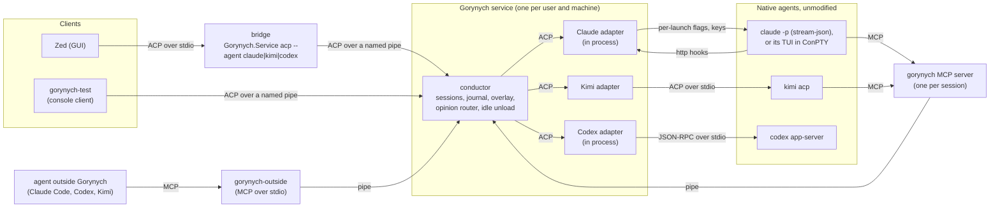
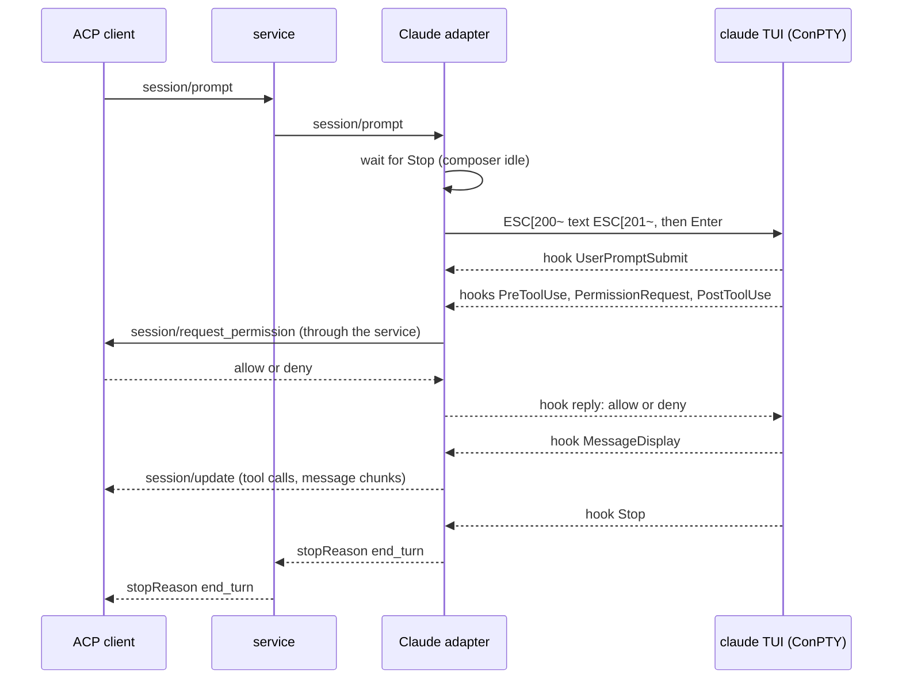
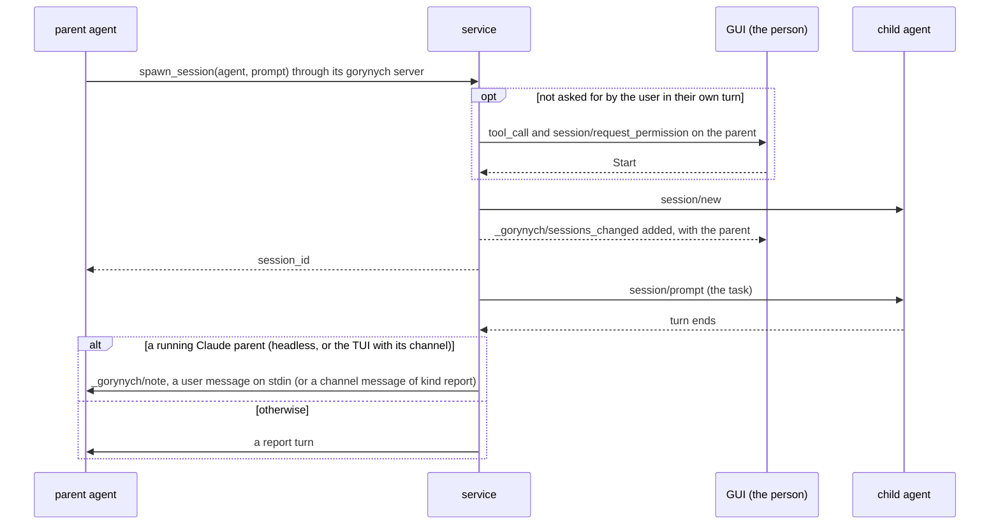
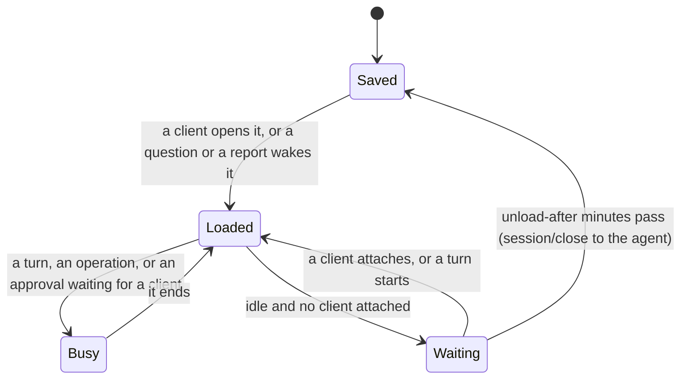

# Design

Why Gorynych is built the way it is: the decisions, the architecture, how it maps onto ACP,
what the probes proved, and what is still a plan. The specifications that the code follows
live next to this file: [service protocol](service-protocol.md),
[adapter contract](adapter-contract.md), [adapters](adapters.md), [ACP types](acp-types.md),
[external clients](external-clients.md). Where this document and a specification disagree,
the specification wins.

Status words used below: **done** (in the code and tested), **in progress** (on a branch),
**planned** (decided, not started), **open** (not decided or not checked).

## Contents

- [Goal](#goal)
- [Decisions](#decisions)
- [Architecture](#architecture)
- [Claude Code without touching its configuration](#claude-code-without-touching-its-configuration)
- [Kimi, Codex and DeepSeek](#kimi-codex-and-deepseek)
- [The protocol: ACP and its extensions](#the-protocol-acp-and-its-extensions)
- [Sessions: catalog, titles, archive](#sessions-catalog-titles-archive)
- [Sessions that talk to each other](#sessions-that-talk-to-each-other)
- [Waking and idle unload](#waking-and-idle-unload)
- [Agents outside Gorynych](#agents-outside-gorynych)
- [Several machines](#several-machines)
- [Updating without losing work](#updating-without-losing-work)
- [The GUI](#the-gui)
- [Stage one and what comes next](#stage-one-and-what-comes-next)
- [Probe results](#probe-results)
- [Open questions and risks](#open-questions-and-risks)

## Goal

Two to five coding agents at once, interactive and supervised, from different vendors. The
point is a plurality of opinions from different models, so the agents must be able to ask each
other, and the person must see all of them in one place: one feed per session, one kind of
approval card, one session list, without reading terminals.

## Decisions

- **Native harnesses, unmodified.** Each agent runs as its own program, the one its vendor
  ships, under the person's own login. Gorynych adds no model calls of its own and never
  replaces a harness with a bare model.
- **Never edit an agent's own configuration** (`~/.claude`, `~/.codex`, `~/.kimi-code`).
  Everything goes through per-launch options and the agents' own protocols, so starting or
  removing Gorynych changes nothing in how the agents behave on their own.
- **A structured protocol per harness, no screen scraping.** Kimi speaks ACP (`kimi acp`),
  Codex has `codex app-server`, Claude Code has stream-json (`claude -p`). In Claude's TUI
  fallback the terminal is used only to type and to answer the few dialogs that need a key.
- **Claude Code runs headless; the TUI is the fallback.** The unmodified `claude` binary runs as
  `claude -p` with stream-json in and out, under the person's own plan login, one process per
  session (decided 9 November 2026). Anthropic's help center says `claude -p` and the Agent SDK
  signed in with a plan draw from its limits, and the legal page does not prevent signing in
  to the unmodified binary with one's own subscription. The interactive TUI in a pseudo console
  stays built and tested behind `--claude-transport tui`: a separate credit for `-p` was
  announced and then paused in 2026, and `--bare` (no OAuth login) is to become the default for
  `-p`. Switching needs no migration; both use Claude's own transcripts.
- **Service and GUI are separate from day one.** A per-user background service on each
  machine owns the agent processes; a GUI connects to it, and later to several services.
- **Several machines meet in a service, not in the GUI** (decided 10 November 2026). A service
  brings in the sessions of other machines' services as one more adapter; a GUI may still
  connect to any service directly ([Several machines](#several-machines)).
- **An update breaks no turn** (decided 10 November 2026). Adapters are to run in host processes
  of their own, so the conductor can restart under running agents
  ([Updating without losing work](#updating-without-losing-work)).
- **ACP v1 between them**, with own additions only through ACP's extension points. The
  service is an ACP conductor (the proxy-chains RFD); adapters are ACP agents.
- **Adapters are build-time assemblies** (or external ACP executables). Loading assemblies at
  run time would break Native AOT, which the service keeps.
- **Native state is the source of truth.** Titles and archive live in the harness when it has
  them; the service keeps only an overlay for the rest.
- **One person, own subscriptions.** Each machine uses its own login; credentials never move
  between machines; Gorynych serves nobody else.
- **Standards first.** Before inventing a format, name the closest standard and conform to it
  or extend it through its documented extension points.

## Architecture



- **The service** (`src/Gorynych.Service`) is a per-user background process, not a Windows
  service: session 0 could not start agents under the person's login without storing a
  password. The bridge, the test client or the outside server starts it when it is not
  running, and it outlives them. One instance per user and pipe, across logon sessions.
- **Transport.** Locally, a named pipe (`gorynych-acp-<user>`) carrying ACP's stdio framing,
  open only to the current user. Plain ACP clients start agents over stdio, so the **bridge**
  (`Gorynych.Service acp --agent <name>`) passes ACP between its stdio and the pipe and scopes
  the connection to one agent. Remote machines: over `ssh -T` to the bridge there
  ([Several machines](#several-machines), **planned**).
- **The conductor** keeps what is common: process supervision, a bounded journal per session
  (replayed by `session/load`), the overlay (archive flags, names given at spawn, tombstones,
  parent links), the router for questions between sessions, and the idle unload. Everything
  particular to an agent sits behind the [adapter contract](adapter-contract.md).
- **Adapters are ACP agents.** An external one is an executable that speaks ACP over stdio
  (`kimi acp`); an own one (Claude and Codex) is an assembly with an ACP interface over an
  in-memory link, so moving it into its own process means only wrapping it in JSON-RPC.
  That move is **done** on Windows (10 November 2026): each adapter runs in an *adapter host*, so
  the conductor restarts without breaking a turn
  ([Updating without losing work](#updating-without-losing-work)).
  DeepSeek Harness speaks ACP itself; its adapter is a thin in-process proxy in front of
  `dsh --profile acp`.

## Claude Code without touching its configuration

All of the Claude integration rests on the flags of one launch and Claude's own protocols; no
file in `~/.claude` or in the project changes.

**Headless, the default** ([research/claude-headless-spec.md](../research/claude-headless-spec.md)):

| Need | Mechanism | What it gives |
| --- | --- | --- |
| Feed | `claude -p --input-format stream-json --output-format stream-json --verbose --include-partial-messages --replay-user-messages` | token deltas, thoughts, tool calls and results, a replay of every user message with the `uuid` the adapter gave it, one `result` per turn |
| Approvals and questions | `--permission-prompt-tool=stdio` | `can_use_tool` control requests, answered `allow` or `deny`; `AskUserQuestion` exists only with this host |
| Permission mode, model, effort | `--permission-mode`, `--model`, `--effort`; `set_permission_mode`, `set_model`, `apply_flag_settings` while running | the selectors |
| Messages from other agents and the person | user messages on stdin | a message joins a running turn after its current tool, or starts one |
| Authorization for opinions | `--append-system-prompt` | answer opinion requests with `reply`, take no actions for other agents |
| Title | the `rename_session` control request | Claude's own `custom-title` |
| Folder trust | Claude's own flag, read only, else the person's answer | `-p` asks nothing itself and would run a folder's project hooks and MCP servers |
| The login | the `account` of `initialize` | no login (what `--bare` gives) or an API key fails the prompt loudly |

**TUI, the fallback:**

| Need | Mechanism | What it gives |
| --- | --- | --- |
| Feed | `--settings <file>` with hooks of type `http` | every event POSTed to the adapter: prompt, tool input and result, answer text (`MessageDisplay`), `Stop` with `last_assistant_message`. The person's global hooks keep working |
| Approvals and questions | the `PermissionRequest` hook in the same settings | `allow` or `deny`; an `AskUserQuestion` answer through `updatedInput.answers` |
| Permission mode | `--permission-mode default` | otherwise a global `defaultMode: auto` decides by itself and the approval never reaches the hook |
| Messages from other agents | `--mcp-config` plus `--dangerously-load-development-channels server:gorynych` | a channel delivers messages into the live session. Claude shows a notice at every such launch that needs Enter; Gorynych confirms it only after the person agreed once ([adapters.md](adapters.md#consent-to-development-channels)) |
| Authorization for opinions | `--append-system-prompt` | answer opinion requests with the channel's `reply` tool, take no actions for other agents |
| The person's own prompts | bracketed paste into the PTY, then Enter, after `Stop` | a real user turn; no drafts left in the composer |
| Keeping the conversation | `--session-id <uuid>` at the first launch, `--resume` later | `--resume` does not restore `--settings` or `--mcp-config`, so every launch passes them again |

The transcript is read only for the title: its JSONL format is internal, as the docs of
[hooks](https://code.claude.com/docs/en/hooks) and
[channels](https://code.claude.com/docs/en/channels-reference) say.

A follow-up prompt, in order:



The full mappings, both launch commands and the channel are in
[adapters.md](adapters.md#claude-code). The headless transport needs nothing Windows-only; the
TUI fallback runs on Windows only, and a Unix PTY host is not planned while headless works.

## Kimi, Codex and DeepSeek

All three have a structured protocol, so neither a terminal nor screen reading is needed.

| Harness | Feed | Approvals and input | Status |
| --- | --- | --- | --- |
| [Kimi Code](https://moonshotai.github.io/kimi-code/en/reference/kimi-acp) | `kimi acp`, native ACP | `session/request_permission`, `session/prompt` | **done**; recorded with Kimi Code 2.4.1, verified live on 7 November 2026 |
| [Codex](https://learn.chatgpt.com/docs/app-server.md) | `codex app-server`, official JSON-RPC with a schema per version: item events, `turn/plan/updated` | approvals are server requests to the client; input is `turn/start` | **done**; types generated from codex-cli 0.167's schema, verified live on 8 November 2026 |
| [DeepSeek Harness](https://www.npmjs.com/package/@deepseek-ai/dsh) | `dsh --profile acp`, native ACP (an automation profile: no titles, no load, no delete), behind a thin proxy | `session/request_permission`, only for sandbox escalations; `session/prompt` | **done**; DSH 0.2.2-rc.1, a developer preview on the user's API key, verified live on 9 November 2026 ([adapters.md](adapters.md#deepseek-harness)) |

DSH's earlier HTTP API (`/api/session/...` of `dsh web`) is not used: its ACP profile carries
the harness itself.

How messages travel, per harness:

- **The person's prompt:** `session/prompt` for Kimi and DSH, `turn/start` for Codex, a user message on
  stdin for Claude (a paste into the PTY after `Stop` in the TUI fallback).
- **A question from another agent:** into a running Claude, on stdin (the TUI's channel in the
  fallback), answered with `reply`; to the others as an ordinary turn marked with the asking
  session ([below](#asking-another-session)).
- **An approval:** Claude's `can_use_tool` (the TUI's `PermissionRequest`), Kimi's `session/request_permission`, Codex's
  server request and DSH's `session/request_permission` all become one
  `session/request_permission` card. DSH asks only for sandbox escalations; its sessions' shell
  escalations are refused by the adapter, and the service asks before DSH's gorynych tool calls.

## The protocol: ACP and its extensions

GUI and service speak ACP v1 entirely; anything of Gorynych's own is an extension by ACP's own
rules. To a GUI the service is an ordinary ACP agent with many sessions; to its adapters it is
an ACP client. The types are generated from the published JSON schema
([acp-types.md](acp-types.md)): no maintained ACP SDK for .NET existed.

| Need | In ACP | Status in ACP | What Gorynych does |
| --- | --- | --- | --- |
| Session list | [`session/list`](https://agentclientprotocol.com/protocol/v1/session-list): `sessionId`, `cwd`, `title`, `updatedAt`, `_meta`, pages by `cursor` | v1 | **done**; the agent and the parent go in `_meta` |
| GUI reconnect | `session/load` replays history through `session/update`; `session/resume` returns the session without it | v1 | **done**; the history comes from the service's journal |
| Feed | `session/update`: message and thought chunks, `tool_call`, `tool_call_update`, `plan`, `usage_update`, `session_info_update` | v1 | **done**, as is; every chunk carries a `messageId` |
| Prompts and cancel | `session/prompt`, `session/cancel` | v1 | **done**; the Claude adapter turns a prompt into a user message on stdin (a PTY paste in the TUI fallback) |
| Approvals | `session/request_permission` | v1 | **done**; Claude's hook and Codex's server requests map to it |
| Questions with choices | `elicitation/create` (forms) | v1 | **done** for `AskUserQuestion`; a client without forms gets approvals instead |
| System prompt | `systemPrompt` (append or override) on new, load and resume | completed RFD, in ACP main | **done**: the service sends its peer instructions to agents that advertise it (Claude) |
| Loaded or not | `session/status` (`open`, `saved`) | draft RFD | the same words in `list_agents`; adopt when stable |
| Title and archive | `session/set_title`, `session/archive` | draft RFDs | own `_gorynych/archive` and overlay names meanwhile; adopt when stable |
| List changes | `session/list/subscribe` | open PR | own `_gorynych/sessions_changed` meanwhile |
| Child sessions | subagents RFD (`subagent_update`) | active RFD | not used: it forbids prompting a child; own parent link instead ([below](#child-sessions)) |
| Questions between agents | none | — | own `_gorynych/opinion`, through the `gorynych` MCP server |
| The service as an intermediary | [proxy-chains RFD](https://agentclientprotocol.com/rfds/proxy-chains.md): a conductor, `proxy/initialize`, `proxy/successor` | unstable RFD | the service is a conductor in that sense; no `proxy/*` methods until the RFD settles |
| Transport | [stdio only](https://agentclientprotocol.com/protocol/transports); Streamable HTTP and WebSocket are an RFD draft | v1 / RFD | a named pipe locally, stdio through the bridge; remote over `ssh -T` (**planned**); a standard network transport once accepted |

Extensions follow ACP's [extensibility rules](https://agentclientprotocol.com/protocol/v1/extensibility):
own fields only under `_meta` with namespaced keys (`gorynych/…`), own methods prefixed with
`_` (`_gorynych/…`), support advertised in `agentCapabilities._meta` at `initialize`. So a
plain ACP client works with the service unchanged and simply ignores what it does not know.
The full list is in [service-protocol.md](service-protocol.md#extensions).

## Sessions: catalog, titles, archive

Titles and archive live in the harness when it has them; otherwise in the service's overlay.

| Harness | List | Title | Archive |
| --- | --- | --- | --- |
| Claude Code | the adapter's own list of the sessions it started; sessions started elsewhere: **left out**, possible but laborious and fragile (below) | Claude writes `ai-title` itself; `/rename` writes `custom-title`. A name given at spawn stays in the overlay | none in Claude Code: overlay |
| Kimi Code | ACP `session/list` | first prompt; a name given at spawn stays in the overlay | Kimi has one, but `kimi acp` cannot reach it: overlay |
| Codex | `thread/list` | `thread/name/set` for a name given at spawn; a thread without a name shows the service's provisional title | Codex will not resume an archived thread, so the archive stays in the overlay |

- **Sessions start from the first prompt.** Creating a session is the composer: pick the agent
  and the folder, write the first prompt. The service runs `session/new` and `session/prompt`;
  for Claude the prompt is the launch argument. The title arrives by itself as a
  `session_info_update` (Claude's `ai-title` a few seconds after the first answer).
- **Drafts disappear.** A session created but never prompted (Zed creates one whenever a thread
  view opens) is deleted when its client lets go of it, and never listed.
- **Deleting** is native where the agent can (Kimi); a Claude session is only hidden, its
  transcript belongs to `~/.claude`.
- **One thread, one writer.** Codex lets one process write a thread; a thread that Codex Desktop
  or the CLI holds is marked in the session list with the app that holds it, and fails to open
  through Gorynych at once, naming that app (`gorynych/openElsewhere`, **done**).
- **Claude sessions started elsewhere: possible, but laborious and fragile, so left out for
  now.** This was looked at on 10 November 2026 with Claude Code 2.1.321; nothing below was
  probed yet.
  - *What already works.* Claude Desktop, the terminal `claude` and the adapter write their
    transcripts to the same `~/.claude/projects`. `claude -p --resume <id>` takes any of them,
    and the catch-up imports a session the journal has never seen
    ([service-protocol.md](service-protocol.md#history-made-outside-gorynych)).
  - *Listing.*
    - What to read: the head of each transcript (the folder, the first prompt) and its tail
      (`ai-title`, `custom-title`), as the Agent SDK's `listSessions` does. Subagent
      transcripts are skipped.
    - Telling sessions apart: every line carries `entrypoint`: `claude-desktop`, `cli`, or
      `sdk-cli` for `claude -p`. `sdk-cli` covers Gorynych's own sessions, but also scripts,
      hooks and probes.
    - The size here: 510 transcripts in 72 folders, 3.7 GB.
  - *Why it is fragile.*
    - As far as we know, Claude does not stop a second process from resuming a live session.
      With two writers, the transcript forks into two branches. Each process sees only its
      own turns, and the next resume silently drops one branch from the context.
    - Unlike Codex, nothing native would refuse the open, so the only guard would be
      Gorynych's own. The one source for it is the live-session registry
      `~/.claude/sessions/<pid>.json`, which backs Claude's cross-session messaging but is not
      documented. Each entry has `sessionId`, `pid`, `entrypoint` and `status`, and for
      Desktop its `local_…` id and sidebar title.
    - If the registry's format changes, the guard fails open: nothing is marked, and opening
      the session forks its transcript.
  - *Why it is worth less than with Codex.*
    - Claude Desktop keeps its own session list, so sessions started in Gorynych would not
      show there. The switch would work one way only.
    - Desktop also keeps a process for every open session, as Codex Desktop holds its threads.
  - *The safe variant, if it is ever needed.* Open an outside session as a fork
    (`--resume <id> --fork-session`): a new session with the same history, the original left
    untouched. The registry would then serve only as an "open in Claude Desktop" hint.
- **Renaming from the GUI** goes to the native side (Codex `thread/name/set`, Claude `/rename`
  typed through the PTY after `Stop`): **planned**.

## Sessions that talk to each other

Every session gets a `gorynych` MCP server through ACP's `mcpServers`:
`Gorynych.Service peers --pipe <pipe> --token <token>`, with a random token per session that
tells the service who is calling. Its tools: `list_agents`, `ask_agent`, `spawn_session`,
`archive_session`, `restore_session` and `reply`. All **done**; the exact texts agents see are
in [service-protocol.md](service-protocol.md#what-agents-are-told).

### Asking another session

```mermaid
sequenceDiagram
  participant P as asking agent
  participant M as its gorynych MCP server
  participant S as service
  participant Q as asked session
  P->>M: ask_agent(session_id, question)
  M->>S: _gorynych/opinion (peer token)
  alt Claude, running (headless: on stdin; TUI: through its channel)
    S->>Q: _gorynych/opinion
    Q->>Q: a user message (or channel message) naming the adapter's message_id
    Q->>S: reply(message_id, text) through the adapter
  else Kimi, or Claude not running or without a live-note path
    S->>Q: session/prompt, a turn marked with the asker and message_id
    Q->>M: reply(message_id, text)
    M->>S: _gorynych/reply
  end
  S-->>M: the answer
  M-->>P: tool result
```

- The asked session is woken if it is not loaded ([below](#waking-and-idle-unload)); a turn
  waits for the session's running turn, because ACP cannot inject into a turn.
- A session that is answering a request cannot ask another meanwhile, so two agents cannot wait
  on each other.
- No gorynych tool needs the agent's own approval. The service asks the person itself before a
  spawn they did not ask for in their own turn, and before a session that is not in full access
  asks one that is, since the asked agent runs anything unasked and so could lend the asker its
  rights ([service-protocol.md](service-protocol.md#approvals)).

### Child sessions

ACP's subagents RFD hides a subagent from `session/list` and forbids prompting it. Gorynych
needs the opposite: a coordinator hands work to coder sessions, and the person can open and
prompt any of them. So a child is an ordinary top-level session that names its parent in
`_meta["gorynych/parentSessionId"]`; a stock client shows it as one more session, a Gorynych
GUI draws the tree.



Each finished turn of the child (its first, or one the person prompted) is reported to the
parent with its final message, unless the spawn said `report: false`. A spawn is asked unless
the agent says the user asked for it (`initiation: user_asked`) and the turn began with the
user's own prompt, with no other session's text (a question, a report) come into it; the answer
is never "always".
The child starts in its agent's default mode, never in its parent's full access. Details:
[service-protocol.md](service-protocol.md#child-sessions).

When the scheme settles, the parent link is a candidate for its own ACP RFD (**planned**).

## Waking and idle unload

A session stays loaded in its agent while a client has it open or something uses it. Once it is
idle and no client is attached, the service closes it in its agent after `--unload-after`
minutes (10 by default), which frees Kimi's memory or ends Claude's process. A question, a
report or a client brings it back. **Done.**



- Unloading never cancels anything. A session whose approval waits for an answer stays loaded,
  so a client that comes back can answer it.
- A client that goes away without `session/close` (Zed quits that way) counts as letting go of
  every session it had open.
- `session/close` from the last client cancels a running turn that a client's prompt started,
  as ACP asks; questions, reports and turns the agent runs itself go on.

Details: [service-protocol.md](service-protocol.md#unloading-idle-sessions).

## Agents outside Gorynych

An agent the person runs outside Gorynych (Claude Code in a terminal or Claude Desktop, Codex,
Kimi Code) can list Gorynych's sessions, read what they said and ask one for its opinion,
through a small stdio MCP server, `gorynych-outside` (`src/Gorynych.Outside`), that the person
registers in that agent. The answer comes back in the same tool call; an outside agent cannot
prompt, spawn, archive or reply, and no Gorynych session can ask it anything. The server hides
its tools from sessions running inside Gorynych. **Done**; setup in
[external-clients.md](external-clients.md#agents-outside-gorynych).

It is a separate executable because hosts keep MCP servers running for hours, and Windows
cannot overwrite a running exe: the service could not be updated while an outside agent was open.

## Several machines

The person works on several machines, for example a home PC and a powerful work PC that is on
around the clock, and sometimes on a laptop while the home PC sleeps. Each machine runs its own
service with its own agents and logins. All of this is **planned**.

**A service is the hub, not the GUI.** A service connects to the services of other machines as
one more adapter. A remote Gorynych is an ACP agent, and a conductor can stand behind another
conductor, as the proxy-chains RFD has it.
- **One list.** The GUI and the outside server see one list, with `claude@R-PC-167` and the
  like next to the local agents. Each remote session carries its machine in `_meta`; the
  persistent service ID tells services apart.
- **Asking and spawning from the hub's machine.** `ask_agent` and `spawn_session` reach a
  remote session through the hub, as ordinary requests to the remote service. A coordinator
  at home can so start coders on the work PC.
- **Asking from the remote machine.** A remote session that asks one on the hub's machine goes
  through its service, which sends a `_gorynych/…` request to its client, the hub. ACP lets an
  agent send requests to its client; permission requests already travel that way.
- **The remote service keeps its journals.** The hub keeps no copy: it passes `session/load`
  and its replay through.
- **Why not the GUI.** The GUI was the earlier plan: the GUI connected to each service and
  forwarded questions between them, so the services did not know each other. In Zed that
  meant a separate entry for every agent on every machine, no combined list, forwarding
  written in the fork in Rust, and questions between machines only while Zed is open. The
  outside server would also have seen only its own machine. The hub means fewer points of
  failure, and Zed needs no change.

**Rules.**
- **No ownership.** A remote service never depends on a hub, which is only one more of its
  clients. Its sessions, journals and approvals stay its own. A hub going to sleep is a client
  leaving; the agents work on, and an approval goes to whichever client is attached.
- **A GUI may connect to any service directly.** For example, from a laptop to the work PC
  while the home PC sleeps: everything on the work PC works, and the home sessions are simply
  out of reach until the home PC wakes and its hub reconnects.
- **Hub is a role, not a machine.** Any service may list remotes, even one with no agents of
  its own. Then a laptop with Gorynych and no agents shows whatever machines it can reach.
- **One hop.** A hub shows and forwards only the sessions a remote service hosts itself, never
  what that service gathers from others. So any graph of connections is safe: the home PC and
  the work PC may list each other, and the laptop both, without duplicates or loops.
- **A hub attaches to a remote session only while one of its own clients has it open.** So a
  hub with nobody at it never takes an approval that a person on another client is waiting
  for.
- **An unreachable machine is an error at once, not a wait.** For example: "R-PC-167 is not
  connected".

**Transport: `ssh -T` to the bridge on the remote machine.**
- ACP standardizes only stdio so far. ssh brings key authentication and needs no open port,
  so it also reaches a machine inside a corporate network.
- The hub starts ssh and starts it again when the connection drops. It then resumes the
  sessions its clients have open. This uses the same resumable link as the bridge and the
  adapter hosts ([Updating without losing work](#updating-without-losing-work)).
- An earlier note said that the standard OpenSSH for Windows hangs on synchronous pipes. The
  first probe saw no hang: OpenSSH for Windows 9.5 and Git's ssh both worked for a client with
  synchronous pipes.

**The remote service runs on its own, not under ssh.**
- On Windows a scheduled task starts it at logon, in the person's session and with a limited
  token. Linux and macOS will use `systemd --user` and launchd.
- The bridge behind ssh never starts the service as its own child: started from ssh, the
  service would run elevated, in session 0. When the pipe is missing, the bridge runs the logon
  task instead (**done**).
- A dropped connection then ends only the bridge: the agents work on, and the hub resumes
  their sessions when it reconnects.
- **Checked live** on 10 November 2026, on a Windows 11 work PC:
  - The bridge ran the task, and the service came up in the person's session, not elevated.
  - Claude, Codex and Kimi answered over `ssh -T`.
  - The connection was dropped 720 characters into Claude's answer. Claude finished the answer
    with no client, and 75 seconds later a new bridge's `session/load` replayed it whole.
- The first probe, on 10 November 2026, found that the sshd job lets a child break away. So a
  service started from ssh would survive the drop too, but elevated.

**The pipe must let a local ssh client in.** Done on 10 November 2026
([service-protocol.md](service-protocol.md#endpoint)). Two rules kept it out; the first probe
found both.
- The token sshd gives a key login carries the NETWORK group (S-1-5-2). The pipe's deny ACE
  for NETWORK, meant only for clients over SMB, refused every ssh client. Remote clients are
  now refused with `PIPE_REJECT_REMOTE_CLIENTS` instead.
- ssh gives an administrator an elevated token, and an elevated client reached only an
  elevated service. Now an elevated client of the same user gets into a plain service: that
  direction is safe. The other direction stays shut: a plain process never drives an elevated
  service.
- Checked live on the same day: an elevated ssh login of an administrator got into the plain
  service that the task had started.

**Versions may differ between machines.** The hub and a remote service speak ACP and the
extensions each announces at `initialize`, and pass on fields they do not know. A hub can
update a remote machine: it copies the new build over ssh and starts the update there.

**Code stays where its agents work.**
- Diffs come with the tool calls in the thread.
- For the whole picture, git: the repository is cloned on the remote machine, and its agents
  work in their own branches. The person fetches them, with that machine as a git remote over
  ssh.
- Links to files point to paths on the remote machine.

**Logins.** Each machine has its own: the person signs in to each agent there by hand, and
credentials never move between machines.

## Updating without losing work

Without adapter hosts, stopping the service stops every agent. The adapters live in the
service's process, and the agents are their children on stdio. So a running turn breaks off
mid-step, and pending approvals and questions are lost. What stays is the agents' native
history, the journals and the overlay, so an idle session loses nothing.

**Agreed on 10 November 2026: the process boundary moves to where ACP already is, between the
conductor and the adapters.** Step 3a, the hosts and a conductor that restarts lightly, is
**done** on 10 November 2026 and on by default on Windows
([service-protocol.md](service-protocol.md#adapter-hosts)); step 3b, updating the adapters
themselves, is next.

**Adapter hosts and a light conductor** (3a, **done**).
- An adapter runs in a small process of its own, an *adapter host*. It is the same executable
  in another mode, and it owns its agents and all their state.
- The conductor keeps the journals, the catalog, the routing, the approval policy and the
  peers server. That is the part that changes most often.
- Restarting the conductor takes seconds and breaks no turn:
  1. The old conductor flushes its journals and exits, and the new one starts.
  2. Each host reconnects and reports its live sessions, its running turns and the approvals
     not yet answered. It buffered the updates that came while no conductor was there, and
     hands them over now, so the journal misses nothing.
  3. The bridge reconnects too. It keeps the client's `session/prompt` open and answers it
     when the turn ends, so the GUI sees a pause in the stream, not a break. Without hosts
     (`--hosts off`, the default elsewhere than Windows), a turn ends with the old conductor, so
     `restart` waits for running turns and is called off when they outlast the wait, unless
     `--force` cancels them, and then the bridge answers `cancelled`.
- How it came out:
  - The host is the same executable (`Gorynych.Service host --adapter <name>`), started detached
    by the service on an adapter's first use. It dials the conductor on a pipe of its own
    (`<pipe>.hosts`) and proves itself with a token from the data folder, which a plain client
    does not have.
  - The host numbers each update it passes on (`gorynych/hostSeq`), and the journal keeps the
    number. The next conductor gives each session's newest number as a cursor, and the host sends
    what it kept after it. So the journal misses nothing and doubles nothing, without acks.
  - The host reports each prompt's end before its answer (`_gorynych/turn_ended`), numbered the
    same way, and the conductor marks the end from that report. So an end that came while no
    conductor was there, or that a dying conductor never read, is marked by the next one, once.
  - The next conductor takes the running turns back: they hold their sessions, so a new prompt
    waits for them, and a resuming bridge is told they run.
  - A restart waits for no turn. A prompt waiting behind a running turn is refused and goes to the
    next service. What still lives in the conductor is cut: an `ask_agent` waiting for its answer
    gets an error that says to ask again, with the session ID.
- How many hosts depends on the agent:
  - Claude runs a process per session, so it is to get a host per session. In 3a it has one host
    for the adapter, as the others do: a host per session needs the conductor to route each
    session's requests to its own host, and it pays off only with 3b, where it lets an update of
    the Claude adapter move one session at a time. The link is per host already (numbers,
    cursors, hello), so 3b changes the routing, not the link.
  - Codex runs one app-server for all threads, Kimi one process, and DSH a process per mode.
    Each of them gets one host for the adapter.

**Updating an adapter** (3b, **planned**). Until then a host runs the code it was started with
until it exits: a restart onto a new executable keeps the old hosts and their adapters.
- New sessions start on the new host at once.
- A live session moves over when it is unloaded idle, or when its host has no running turn.
  That is waiting for one adapter, not for the whole machine, and Claude's host per session
  makes it one session at a time.
- A drain is needed only when a host with running turns cannot wait. It starts no new turn,
  holds the prompts that come in, and waits for the running turns.

**One resumable link, three uses.** The same mechanism serves:
- the hub and a remote service over ssh;
- the bridge and the service across a restart (**done** on 10 November 2026:
  `ResumableLink` and `Gorynych.Service restart`,
  [service-protocol.md](service-protocol.md#the-resumable-link));
- the conductor and its hosts (**done** in 3a with its own small protocol on the same ideas:
  the host keeps what the conductor lacks, numbered, and sends it after a cursor).

Each time one side lives on while the other restarts or loses the connection. After
reconnecting they shake hands again, list the live sessions, hand over the updates after the
last acknowledged one, and send the pending requests again. So it is built once.

**Standards for the link.** Checked on 10 November 2026: ACP schema v1.30.0, MCP 2026-07-28.
- Neither standard redelivers messages missed while disconnected.
  - ACP's draft RFD for Streamable HTTP and WebSocket keeps sessions across a disconnect, and
    a client resumes them with `session/load`. But it redelivers nothing sent in between, and
    leaves message IDs and resumption to v2.
  - MCP 2026-07-28 dropped resumption by `Last-Event-ID`: the request is its unit of recovery.
  - The proxy-chains RFD calls restarting a component conductor behaviour, not protocol.
- So the link uses what ACP has:
  - Reconnecting is `session/resume` for each live session (stable since April 2026).
  - It carries a replay cursor shaped like the v2 draft's `replayFrom`:
    `_meta["gorynych/replayFrom"]` with a `gorynych/after` mark, as the
    [native catch-up](service-protocol.md#history-made-outside-gorynych) already sends.
  - The side that lives on sends its pending requests again.
- How the bridge's link meets each point (10 November 2026):
  - The resume: the bridge sends `session/resume` for every session its client has open, after
    sending the client's `initialize` again. Its version goes in `agentCapabilities._meta`
    (`gorynych/link: 1`), and a bridge with an older service does not reconnect.
  - The cursor: every journaled update carries its position (`gorynych/position`), which is the
    `mark` of `gorynych/after`; the service sends what follows it before the resume's answer.
  - Pending requests: the service, which lives on in a dropped connection, sends a pending
    approval to the client that resumes, and the bridge joins it to the one its client has. The
    bridge, which lives on in a restart, sends again the client's requests that may run twice,
    holds a prompt in flight until the mark of its turn's end (`gorynych/promptId`), and fails
    any other with an error. ACP has no message IDs to deliver once by, so the bridge keeps
    IDs of its own toward each side.
  - Still open: v2's own `replayFrom` and `session/attach`, to move to once they are stable.
- To align with later:
  - v2 of the transport RFD;
  - a proposed `session/attach` with delta sync after a message ID (not yet checked).

**Edge cases** (as decided in 3a).
- **Versions.** A new conductor talks to older hosts: the host link's version is in the host's
  hello and its `initialize` answer (`gorynych/host`), and a conductor takes a range of them. There
  is only version 1 yet; from the next one on, the range keeps at least the previous version.
  Bridges keep running the old code until the GUI restarts, so the bridge stays thin.
- **Options.** A host keeps the adapter options it was started with (`--claude-*`) until it exits;
  applying new ones to running hosts belongs to 3b.
- **Orphans.** A host whose conductor does not come back, after a crash or an uninstall, lets its
  turns run for up to 10 minutes and exits once nothing runs (2 minutes after it lost the
  conductor at the earliest, also when it is idle); at 10 minutes it cancels what still runs and
  exits. What it did meanwhile is in the agents' own history, not in a journal.
- **A host that dies** ends its turns `cancelled`, with their marks, and the next request starts
  another.
- **The peers server inside an agent** connects for each call, and waits up to 30 seconds for a
  service that restarts. An `ask_agent` that was waiting during the restart returns an error
  that says to ask again.
- **Job objects.** Hosts are detached from the service's process, as `DetachedProcess` already
  does for the service.
- **Platforms.** Hosts are on by default on Windows only, where they are tested; on Linux and
  macOS they build, but are off unless `--hosts on`.
- **The first update** onto this scheme still stops the agents: the service it replaces has no
  hosts.

This replaces the two levels considered first. One was a drain of the whole machine before
every update. The other was a keeper of the agents' raw stdio, which needs the adapters' state
rebuilt in mid-turn. With hosts that state never has to be rebuilt, because it lives on.

## The GUI

Stage one uses [Zed](https://zed.dev), which already draws the feed, diffs, forms and selectors
and runs the service as an external agent through the bridge, one entry per agent. Stock Zed
lacks two things Gorynych needs: sessions an agent creates reach it only through a manual
import (and land in the archive), and it has no session tree. A Zed fork adds both (picking up
sessions as the service announces them, and nesting children under their parents); it is
**in progress** and public at [Phoenix-/zed](https://github.com/Phoenix-/zed) (branch `gorynych`), with a Windows
build of every change on the rolling [nightly](https://github.com/Phoenix-/zed/releases/tag/nightly) prerelease. Its changes stay in rarely changing parts of Zed, so it
can follow Zed's stable releases. Once the scheme settles, the pickup is a candidate for Zed
itself, and the fork shrinks.

If the fork does not work out, the fallback is an own shell (C# and WinUI) with the tree and
a feed in WebView2 built on existing ACP components (**planned**, only if needed). How Zed
treats sessions, and what the service does about it, is in
[external-clients.md](external-clients.md#zed).

VS Code's Agents window, a preview since VS Code 1.120, may become a second GUI. **This looks
interesting, but it is not planned yet.** The window does not speak ACP. It speaks Microsoft's
[Agent Host Protocol](https://microsoft.github.io/agent-host-protocol/) (AHP, 1.0 since
2 October 2026): a sessions server holds the state, several clients see it in sync over a
WebSocket, and a client that reconnects gets what it missed. A third-party host is added
through VS Code's `chat.remoteAgentHosts` setting.

AHP leaves the session list to the host. A client asks for it with `listSessions` on
`ahp-root://`, a page at a time, and the host reports changes with `root/sessionAdded`,
`root/sessionRemoved` and `root/sessionSummaryChanged`. Archived and read are bits of a
session's status; renaming has no command of its own, and there is no fork. Where the host
keeps its sessions, and whether sessions made elsewhere show, the spec leaves to the host.

On 10 November 2026 the window drove the service through
[ahp-acp-gateway](https://github.com/formulahendry/ahp-acp-gateway), which ran
`Gorynych.Service.exe acp --agent claude` as an ACP agent. A prompt was answered, a file write
asked for approval, and the session appeared in the service's list. The gateway, though,
answers `listSessions` from a database of its own and never asks the service's `session/list`,
so the window does not see the service's existing sessions, and Gorynych's `_meta` is lost.
Teaching the gateway to import the list would still leave a second copy of the catalog, which
drifts from the native one (titles, archive). A full integration needs an AHP face on the
service, next to ACP. Until then the gateway is the way in
([external-clients.md](external-clients.md#vs-codes-agents-window)).

VS Code itself has no ACP. A generic ACP provider for it is an open pull request,
[microsoft/vscode#340863](https://github.com/microsoft/vscode/pull/340863), awaiting review and
unchanged since 6 November 2026. Merged, it would not show existing sessions either: VS Code's
agent host lets a provider bring in sessions made outside (`startChatDiscovery`,
`onDidDiscoverChats`), but that provider implements neither and never calls `session/list`.

What an AHP face would take, checked on 10 November 2026:
- **Types and reducers** come from Microsoft's .NET SDK,
  `Microsoft.VisualStudioCode.AgentHostProtocol` (MIT). Its net8.0 assets are marked AOT
  compatible and use source-generated System.Text.Json. It is a client SDK, though: its
  `Abstractions` (wire types, JSON context) and its reducers serve a host too, but the
  WebSocket listener, the JSON-RPC dispatch, the action log with `serverSeq` and the replay on
  reconnect are ours. The fallback is generating types from AHP's JSON Schema (`schema/` in its
  repository), as `Gorynych.AcpGen` does for ACP.
- **The list** comes from the service's catalog, so the window sees what Zed sees. Titles and
  the archive bit are read and written natively, as for Zed
  ([Sessions](#sessions-catalog-titles-archive)). The client picks a new session's URI in
  `createSession`, so the overlay keeps the map from that URI to the session's ID.
- **Child sessions** might become chats: an AHP session holds several, including ones the agent
  starts. Whether the window lets a person prompt such a chat is not checked.
- **The commands.** The 21 the gateway serves were enough for the trial: `initialize`,
  `reconnect`, `ping`; `listSessions`, `createSession`, `disposeSession`, `createChat`,
  `disposeChat`, `subscribe`, `unsubscribe`, `dispatchAction`, `fetchTurns`;
  `resolveSessionConfig`, `completions`; reading the host's files (`resourceList`,
  `resourceRead`, `resourceResolve`, `createResourceWatch`); `createTerminal`,
  `disposeTerminal`; `invokeChangesetOperation`. VS Code 1.145.2 calls more, which the window
  did without: writing the host's files, `moveChat`, automations, `sessionConfigCompletions`
  and `tools/*`. The trials were short, and a tool card did not stay in the transcript.
- **The weight** is in the state, not in the commands: session and chat state built from
  actions, a journal and a replay, close to the service's journals and the
  [resumable link](service-protocol.md#the-resumable-link).

Model, mode and effort selectors for Claude are deferred: the Claude adapter exposes none yet.
The Codex adapter exposes all three as ACP session config options.

## Stage one and what comes next

Stage one is local: one machine, one service, one GUI. Service and GUI are separate processes
from the start, so one GUI can later connect to several services.

Done in stage one:

- the service: one instance per user, a bounded journal per session, a persistent service ID,
  a named pipe open only to its user, the bridge for stdio clients;
- Claude headless (`claude -p`, stream-json): streamed answers and thoughts, approvals over
  `can_use_tool`, live notes on stdin, model, effort and mode selectors, the native rename,
  folder trust, and loud failures off the plan; the TUI fallback in ConPTY with http hooks,
  the channel with `reply`, pastes after `Stop`, and the person's consent before the
  development-channels notice is confirmed;
- Kimi through `kimi acp`, the second kind of adapter, which checked the whole model;
- Codex through `codex app-server`, the second own adapter, with its permission modes as a
  selector (including Codex's automatic reviewer);
- DeepSeek Harness through `dsh --profile acp` behind a thin proxy, with a read-only shell and
  approved file writes;
- questions between sessions, child sessions with reports, archive, list changes;
- agents outside Gorynych, idle unload;
- contract tests on recorded fixtures and a fake Claude, and opt-in live tests.

Next, in order (**planned**):

1. A remote service reachable over `ssh -T`: the pipe lets a local ssh client in, and the
   service starts from a scheduled task with a limited token
   ([Several machines](#several-machines)). **Done**, and checked live on 10 November 2026.
2. The resumable link, and the bridge's reconnect over it
   ([Updating without losing work](#updating-without-losing-work)). **Done** on 10 November
   2026, with `Gorynych.Service restart`, and checked live through the bridge on one machine.
3. Adapter hosts, and a conductor that restarts without breaking a turn. **3a done** on 10
   November 2026: the hosts, one per adapter, and a restart that waits for no turn, on by
   default on Windows ([service-protocol.md](service-protocol.md#adapter-hosts)).
4. Updating an adapter on the fly (3b): new sessions start on the new host, and a live one moves
   over once it is idle; with it a host per Claude session.
5. Read-only sessions, first for a Codex thread open in another app (agreed on 10 November
   2026). Today opening such a thread shows the journal, which may be stale, when Gorynych has
   one, and fails when it has none. Instead:
   - the service shows the thread's current history, read without taking the thread
     (`thread/turns/list`);
   - it says so with an ACP session notice (`notice`, which Zed shows), and refuses a prompt
     in words while the thread is held, but sends it once the thread is free;
   - the flag reaches the client: `_meta["gorynych/interactivity"]`, `full` or `read-only`
     (absent means `full`, as AHP's `ChatInteractivity` has it), with the reason
     (`gorynych/openElsewhere`), on `session/load`, in `session/list` and in
     `session_info_update`;
   - Zed learns read-only sessions as such, not only for Codex: the input is off and the reason
     shown, as Zed does for a subagent's thread, and it comes back when the flag clears. It is
     built in the fork so that it can go to Zed itself, and a session interactivity like AHP's
     is proposed to ACP as an RFD, so that Zed can take a standard field rather than our `_meta`;
   - the first `session/list` already carries the marks, and its order follows Codex's own
     times, so the list does not jump.
6. The hub: remote services as an adapter over the same link, and one list.
7. Questions and child sessions between machines, through the hub.

## Probe results

Before any production code, three probes checked how Claude Code can be driven without editing
its configuration. They ran on 6 November 2026 on Windows 11 with Claude Code 2.1.302 and Haiku
5.5. The hashes of `~/.claude/settings.json`, `CLAUDE.md` and `~/.claude/.claude.json` matched
after each, and the repository's `git status` did not change. The probe programs and their
findings are in [research/probes](../research/probes/README.md).

| Probe | What was checked | Result |
| --- | --- | --- |
| 1. Feed and approvals through hooks | http hooks through `--settings`; a C# listener answers `PermissionRequest` | The prompt, tool calls and results, the answer text and `Stop` arrived. A Write went through on `allow` from the hook, and the hook answered `AskUserQuestion` itself. `SessionStart` did not arrive over http |
| 2. A channel without authorization | an own stdio MCP channel; messages while idle and while working | While idle a message starts a new turn at once; while working it is delivered right after the current tool result. Claude did the first request and refused the next two as third-party input |
| 3. A channel with authorization, and an own ConPTY host | `--append-system-prompt` allows opinions and forbids actions; the C# host presses Enter and pastes text | Claude answered one agent's opinion request through `reply` with the right `message_id` and finished the person's task; it refused another agent's request to create a file and told the person. A paste through the PTY arrived as an ordinary user turn 0.4 s later |

Smaller findings that still hold:

- `server:<name>` finds a server from `--mcp-config`, so no `.mcp.json` in the project is needed.
- Claude turns on bracketed paste (`ESC[?2004h`); multi-line text arrives in one piece.
- `reply` is a deferred tool: Claude first loads it through ToolSearch, and the call asks for
  permission (the adapter's `PermissionRequest` hook now allows it without asking).
- Before `initialize`, Claude tries the newer MCP method `server/discover`; refusing it breaks
  nothing.

Later probes (Codex `app-server`, the outside server against Claude and Kimi) are recorded in
the same folder.

## Open questions and risks

Open:

- Claude subagents in the feed: `SubagentStart`, `SubagentStop`, `agent_transcript_path`.
- Text between tool calls in a long turn: whether all of it comes through `MessageDisplay`.
- The opinion authorization in the system prompt was checked with Haiku only, not with Opus or
  Sonnet.
- Renaming Claude sessions from the GUI. Listing those started outside Gorynych is left out
  ([Sessions](#sessions-catalog-titles-archive)).

Risks:

- **Headless Claude on a plan can be restricted.** Anthropic announced a separate credit for
  `claude -p` and the Agent SDK in May 2026 and paused it in June; `--bare`, which reads no OAuth
  login, is to become the default for `-p`. The adapter fails loudly when a launch shows no
  login or an API key, or when Claude reports an auth or billing error, and the TUI transport
  is one flag away.
- **Channels are a research preview** (TUI fallback only). If Claude Code drops them, questions
  and reports go to Claude as turns, as they already do for a session without the channel.
- **The development-channels notice** needs Enter at every launch. Gorynych confirms it only
  after the person agreed once ([adapters.md](adapters.md#consent-to-development-channels)).
- **Formats change with releases.** Hook payloads and protocols are versioned by their vendors;
  contract tests on recorded fixtures are kept per agent version, and each new version is
  checked against them.
